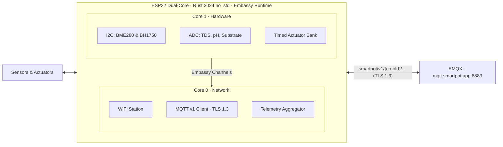

# SmartPot-IoT

[](https://github.com/SmartPotTech/SmartPot-IoT/actions/workflows/ci.yml)

[English](#english) | [Español](#español)

---

## English

### Overview

`SmartPot-IoT-Rust` is the **high-performance Rust firmware** for physical crop devices in the SmartPot platform.
Written in Rust 2024 under a strict `no_std` environment, it leverages the **ESP32** dual-core architecture and the *
*Embassy** cooperative async runtime to deliver maximum speed, reliability, and memory safety without heavy dynamic
allocators.

The device acquires readings across 7 physical variables (I2C and ADC), publishes telemetry under the SmartPot MQTT v1
contract (JSON v1 or 27-byte compact binary v2), executes remote commands with async timers, and emits
acknowledgements (ACK) with human-readable English messages.



### Key Features

* **Rust 2024 `no_std`**: Native microcontroller code without standard library overhead or runtime memory fragmentation
  risk.
* **Embassy Async Runtime**: Cooperative task execution and lock-free static `PubSub` channels for inter-core
  communication.
* **Dual-Core Isolation**: Core 0 dedicated to the Wi-Fi network stack and MQTT v1 link; Core 1 dedicated to sensor
  sampling and real-time actuator control.
* **Full MQTT v1 Contract**: Strict compliance with topics, retained LWT (`offline` / `online`), retained schema 1
  capabilities, null-free telemetry, and English ACK confirmations.
* **Strong Types & Memory Safety**: Zero-allocation serialization and deserialization (`heapless`), rejecting invalid
  commands with typed ACKs.
* **Native Production Stack B Integration**: Fully compatible with the modern SmartPot stack (EMQX with HTTP
  authentication over `SmartPot-API`, TimescaleDB, and SolidJS PWA). Note: for quick software-only prototyping or Wokwi
  simulation, refer to the [SmartPot-IoT-Python](https://github.com/SmartPotTech/SmartPot-IoT-Python) MicroPython
  companion.

### Pinout Assignment

| Component         | ESP32 Pin   | Type                        | Variable / Function                                    |
|-------------------|-------------|-----------------------------|--------------------------------------------------------|
| **BME280** (SCL)  | GPIO 22     | Main I2C Bus (100 kHz)      | Shared I2C clock                                       |
| **BME280** (SDA)  | GPIO 21     | Main I2C Bus (100 kHz)      | `temperature` (°C), `humidity` (%), `atmosphere` (hPa) |
| **BH1750**        | I2C (22/21) | I2C (Address 0x23)          | `brightness` (lux)                                     |
| **TDS Sensor**    | GPIO 34     | ADC1 CH6 (11dB Attenuation) | `tds` (ppm)                                            |
| **pH Sensor**     | GPIO 35     | ADC1 CH7 (11dB Attenuation) | `ph` (0.00 – 14.00)                                    |
| **Soil Moisture** | GPIO 32     | ADC1 CH4 (11dB Attenuation) | `soilMoisture` (%)                                     |
| **Water Pump**    | GPIO 25     | Digital Output              | `WATER_PUMP`                                           |
| **UV Light**      | GPIO 26     | Digital Output              | `UV_LIGHT`                                             |
| **Fan**           | GPIO 27     | Digital Output              | `FAN`                                                  |
| **Humidifier**    | GPIO 5      | Digital Output              | `HUMIDIFIER`                                           |

### MQTT v1 Contract

Canonical prefix: `smartpot/v1/{cropId}/`

| Topic              | Direction       | QoS | Retained | Purpose                                                                                             | Payload / JSON Example                                                                                                                                                                                                             |
|--------------------|-----------------|-----|----------|-----------------------------------------------------------------------------------------------------|------------------------------------------------------------------------------------------------------------------------------------------------------------------------------------------------------------------------------------|
| `.../status`       | Device → Broker | 1   | Yes      | Crop status (LWT & connection)                                                                      | `"online"` / `"offline"`                                                                                                                                                                                                           |
| `.../capabilities` | Device → Broker | 1   | Yes      | Hardware declaration, published after `online` and before `commands`; 7 sensors, 4 actuators, <2 KB | `{"schema":1,"device":{"firmware":"smartpot-iot/0.1.0","hardware":"esp32-devkit-c-v4","telemetry":{"formats":["json-v1","compact-v2"],"compactBytes":27}},"sensors":[…],"actuators":["WATER_PUMP","UV_LIGHT","FAN","HUMIDIFIER"]}` |
| `.../telemetry`    | Device → Broker | 0   | No       | Aggregated sample of physical variables                                                             | `{"temperature":23.4,"humidity":64.8,"brightness":1850,"ph":6.85,"tds":620,"atmosphere":1012.8,"soilMoisture":48.2}`                                                                                                               |
| `.../commands`     | API → Device    | 1   | No       | Actuation command with optional duration                                                            | `{"id":"cmd-1","actuator":"WATER_PUMP","action":"ACTIVATE","durationSeconds":15}`                                                                                                                                                  |
| `.../commands/ack` | Device → Broker | 1   | No       | Execution confirmation in English                                                                   | `{"id":"cmd-1","status":"EXECUTED","message":"Water pump turned on for 15 s"}`                                                                                                                                                     |

### v2 Packet, Edge Filtering and Secure TLS

* **Compact telemetry v2**: optional 27-byte big-endian packet (magic `0x50`, version 2, sequence, SNTP epoch, 16-bit
  presence mask, seven fixed fields, CRC-8) published on the same `telemetry` topic when built with `COMPACT_TELEMETRY`.
  Ranges match the API; an absent, non-finite or out-of-range value clears its presence bit and leaves zero bytes
  instead of saturating the packet.
* **Deterministic rounding**: every scaled field uses symmetric `libm::roundf` (half away from zero), so the firmware
  and the API agree on boundary values.
* **Edge filtering**: each channel runs a median-of-5 window followed by a 1D Kalman filter in Q16.16 with a 3σ
  innovation gate. Spikes keep the estimate and expand the covariance, so a real step is accepted after a few samples
  instead of being locked out.
* **Atomic I2C multiplexing and sensor timing**: the TCA9548A driver selects the channel inside the same bus lock as
  `write`, `write_read` and `transaction`, so concurrent BME280 reads cannot cross channels. The BME280 driver waits 2
  ms after reset and polls the measuring bit with a 20 ms cap.
* **CA-verified TLS 1.3**: `embedded-tls` verifies the broker chain against `CA_CERT_PEM` using the SNTP epoch. A
  missing or invalid CA, or an unsynchronized clock, fails closed: the firmware retries instead of falling back to an
  unverified connection.
* **Command safety**: the last 16 command ids are cached with their ACK; a QoS 1 redelivery repeats the stored ACK
  without toggling a pin. `UV_LIGHT` is canonical and `LIGHTS` is accepted as a legacy alias. `PH_DOSER` and
  `NUTRIENT_DOSER` parse correctly but return a descriptive `FAILED` ACK because this board has no GPIO for them.
* **Tests**: host tests cover the codec, filters, protocol, capabilities and configuration (
  `cargo test --manifest-path tests/host/Cargo.toml`); CI also runs formatting and the ESP32 feature matrix (
  `cargo +esp check`).

### Build-time Environment

The firmware reads its configuration at compile time with `option_env!`. `.env.example` is only a template: exporting it
does not configure a build by itself, and every variable must be present in the environment that runs
`cargo +esp build` (or in the launcher or CI secrets).

| Variable      | Purpose                                                            | Default when absent  |
|---------------|--------------------------------------------------------------------|----------------------|
| `BROKER_PORT` | MQTT broker port; invalid values fall back to `8883`               | `8883`               |
| `USE_TLS`     | `1`/`true`/`yes` enable TLS; `0`/`false`/`no` disable it           | enabled              |
| `CA_CERT_PEM` | PEM CA that signs the broker chain; required when TLS is enabled   | empty (fails closed) |
| `SNTP_SERVER` | SNTP server used to obtain the Unix epoch before the TLS handshake | `pool.ntp.org`       |

Rebuild after changing any value. The other provisioning variables (`SSID`, `PASSWORD`, `CROP_ID`, `DEVICE_KEY`,
`BROKER_HOST`, `COMPACT_TELEMETRY`) use the same mechanism.

### Build Profiles & Commands

```bash
# Syntax and type check
cargo +esp check --ignore-rust-version

# Build executable binary
cargo +esp build --bin smartpot-iot --ignore-rust-version

# Flash to physical ESP32 board and open defmt serial monitor
espflash flash target/xtensa-esp32-none-elf/debug/smartpot-iot --monitor
```

### Integration Testing with Local Demo

```bash
uv run --with paho-mqtt python tests/verify_contract_v1.py
```

### Wokwi Simulation

`diagram.json` reproduces the real pinout: ESP32 DevKit, ADC potentiometers on GPIO34 (TDS), GPIO35 (pH) and GPIO32 (
soil), and actuator LEDs with 220 Ω resistors on GPIO25 (water pump), GPIO26 (UV light), GPIO27 (fan) and GPIO5 (
humidifier). The I2C bus stays on SDA GPIO21 / SCL GPIO22.

Wokwi does not provide functional built-in models for the BME280 or the BH1750 (verified with `wokwi-cli lint`), so the
simulation only covers the ADC inputs and actuator outputs. The firmware logs a warning and keeps running without the
I2C sensors; TDS and pH thermal compensation falls back to 25.0 °C until a real BME280 reading exists. The physical
device uses three BME280 sensors behind a TCA9548A multiplexer at 0x70 (channels 2, 3 and 4, address 0x76) plus a BH1750
at 0x23. That 3×BME topology is physical-hardware-only and cannot be modeled in Wokwi.

### Full Documentation

* [Complete SmartPot-IoT-Rust Documentation](docs/SmartPot_IoT_Rust_Documentation.md)
* [Interactive diagrams](docs/diagrams/interactive/README.md#english): sensor filtering pipeline and command lifecycle, in English and Spanish, with links to the exact source lines

---

## Español

### Descripción

`SmartPot-IoT-Rust` es el **firmware de alto rendimiento en Rust** para el dispositivo de un cultivo real en la
plataforma SmartPot. Diseñado en Rust 2024 bajo un entorno estricto `no_std`, aprovecha la arquitectura de doble
núcleo (Dual-Core) del **ESP32** y el runtime asíncrono cooperativo **Embassy** para garantizar máxima velocidad,
confiabilidad y seguridad de memoria sin depender de asignadores dinámicos pesados.

El dispositivo adquiere lecturas de 7 variables físicas (I2C y ADC), publica telemetría bajo el contrato MQTT v1 de
SmartPot, ejecuta comandos remotos con temporizadores asíncronos y emite confirmaciones (ACK) con mensajes legibles en
inglés.

### Características Principales

* **Rust 2024 `no_std`**: Código nativo para microcontroladores sin sobrecoste de biblioteca estándar ni riesgo de
  fragmentación de memoria en tiempo de ejecución.
* **Embassy Async Runtime**: Ejecución cooperativa de tareas y canales `PubSub` estáticos sin bloqueos (lock-free) para
  comunicación inter-núcleos.
* **Aislamiento Dual-Core**: Core 0 dedicado al stack de red WiFi y enlace MQTT v1; Core 1 dedicado al muestreo de
  sensores y control en tiempo real de actuadores.
* **Contrato MQTT v1 Completo**: Cumplimiento riguroso de tópicos, LWT retenido (`offline` / `online`), capacidades
  retenidas con esquema 1, telemetría sin valores nulos y confirmaciones ACK en inglés.
* **Seguridad y Tipos Fuertes**: Serialización y deserialización sin asignaciones dinámicas (`heapless`), rechazando
  comandos inválidos con ACKs tipados.
* **Integración Nativa con Stack B en Producción**: Totalmente compatible con la pila moderna de SmartPot (EMQX con
  autenticación HTTP sobre `SmartPot-API`, TimescaleDB y SolidJS PWA). Para prototipado rápido en software o simulación
  en Wokwi, consulta el compañero
  MicroPython [SmartPot-IoT-Python](https://github.com/SmartPotTech/SmartPot-IoT-Python).

### Asignación de Pines (Pinout)

| Componente           | Pin ESP32   | Tipo                        | Variable / Función                                     |
|----------------------|-------------|-----------------------------|--------------------------------------------------------|
| **BME280** (SCL)     | GPIO 22     | I2C Bus Principal (100 kHz) | Reloj I2C compartido                                   |
| **BME280** (SDA)     | GPIO 21     | I2C Bus Principal (100 kHz) | `temperature` (°C), `humidity` (%), `atmosphere` (hPa) |
| **BH1750**           | I2C (22/21) | I2C (Dirección 0x23)        | `brightness` (lux)                                     |
| **Sensor TDS**       | GPIO 34     | ADC1 CH6 (Atenuación 11dB)  | `tds` (ppm)                                            |
| **Sensor pH**        | GPIO 35     | ADC1 CH7 (Atenuación 11dB)  | `ph` (0.00 – 14.00)                                    |
| **Humedad Sustrato** | GPIO 32     | ADC1 CH4 (Atenuación 11dB)  | `soilMoisture` (%)                                     |
| **Bomba de Agua**    | GPIO 25     | Salida Digital              | `WATER_PUMP`                                           |
| **Luz UV**           | GPIO 26     | Salida Digital              | `UV_LIGHT`                                             |
| **Ventilador**       | GPIO 27     | Salida Digital              | `FAN`                                                  |
| **Humidificador**    | GPIO 5      | Salida Digital              | `HUMIDIFIER`                                           |

### Contrato MQTT v1

Prefijo canónico: `smartpot/v1/{cropId}/`

| Tópico             | Sentido              | QoS | Retenido | Propósito                                                                                               | Carga / Ejemplo JSON                                                                                                                                                                                                               |
|--------------------|----------------------|-----|----------|---------------------------------------------------------------------------------------------------------|------------------------------------------------------------------------------------------------------------------------------------------------------------------------------------------------------------------------------------|
| `.../status`       | Dispositivo → Broker | 1   | Sí       | Estado del cultivo (LWT y conexión)                                                                     | `"online"` / `"offline"`                                                                                                                                                                                                           |
| `.../capabilities` | Dispositivo → Broker | 1   | Sí       | Declaración de hardware, publicada tras `online` y antes de `commands`; 7 sensores, 4 actuadores, <2 KB | `{"schema":1,"device":{"firmware":"smartpot-iot/0.1.0","hardware":"esp32-devkit-c-v4","telemetry":{"formats":["json-v1","compact-v2"],"compactBytes":27}},"sensors":[…],"actuators":["WATER_PUMP","UV_LIGHT","FAN","HUMIDIFIER"]}` |
| `.../telemetry`    | Dispositivo → Broker | 0   | No       | Muestra agregada de variables físicas                                                                   | `{"temperature":23.4,"humidity":64.8,"brightness":1850,"ph":6.85,"tds":620,"atmosphere":1012.8,"soilMoisture":48.2}`                                                                                                               |
| `.../commands`     | API → Dispositivo    | 1   | No       | Orden de actuación con duración opcional                                                                | `{"id":"cmd-1","actuator":"WATER_PUMP","action":"ACTIVATE","durationSeconds":15}`                                                                                                                                                  |
| `.../commands/ack` | Dispositivo → Broker | 1   | No       | Confirmación de ejecución en inglés                                                                     | `{"id":"cmd-1","status":"EXECUTED","message":"Water pump turned on for 15 s"}`                                                                                                                                                     |

### Paquete v2, filtrado en el borde y TLS seguro

* **Telemetría compacta v2**: paquete opcional de 27 bytes en big-endian (magic `0x50`, versión 2, secuencia, época
  SNTP, máscara de presencia de 16 bits, siete campos fijos y CRC-8) que se publica en el mismo tópico `telemetry` al
  compilar con `COMPACT_TELEMETRY`. Los rangos coinciden con los de la API; un valor ausente, no finito o fuera de rango
  deja su bit de presencia en cero y sus bytes en cero, sin saturar el paquete.
* **Redondeo determinista**: cada campo escalado usa `libm::roundf` de forma simétrica (mitad fuera de cero), así el
  firmware y la API coinciden en los valores límite.
* **Filtrado en el borde**: cada canal pasa por una ventana de mediana de 5 muestras y luego por un filtro de Kalman 1D
  en Q16.16 con puerta de innovación de 3σ. Un pico conserva la estimación y expande la covarianza, de modo que un
  cambio real se acepta tras unas pocas muestras en vez de quedar bloqueado.
* **Multiplexación I2C atómica y tiempos del sensor**: el driver TCA9548A selecciona el canal dentro del mismo bloqueo
  de bus que `write`, `write_read` y `transaction`, así dos lecturas concurrentes de BME280 no cruzan canales. El driver
  BME280 espera 2 ms tras el reset y sondea el bit de medición con un tope de 20 ms.
* **TLS 1.3 con CA verificada**: `embedded-tls` verifica la cadena del broker contra `CA_CERT_PEM` usando la época SNTP.
  Si falta la CA, es inválida o el reloj no está sincronizado, el cliente falla cerrado: reintenta y nunca cae a una
  conexión sin verificar.
* **Seguridad de comandos**: se guardan los últimos 16 ids de comando con su ACK; una reentrega QoS 1 repite el ACK
  guardado sin accionar un pin. `UV_LIGHT` es el nombre canónico y `LIGHTS` se acepta como alias heredado. `PH_DOSER` y
  `NUTRIENT_DOSER` se parsean correctamente, pero devuelven un ACK `FAILED` descriptivo porque esta placa no tiene GPIO
  para ellos.
* **Pruebas**: las pruebas de host cubren el códec, los filtros, el protocolo, las capacidades y la configuración (
  `cargo test --manifest-path tests/host/Cargo.toml`); el CI también ejecuta formato y la matriz de features del ESP32 (
  `cargo +esp check`).

### Entorno de compilación

El firmware lee su configuración en tiempo de compilación con `option_env!`. `.env.example` es solo una plantilla:
exportarlo no configura una compilación por sí solo, y cada variable debe estar presente en el entorno que ejecuta
`cargo +esp build` (o en el lanzador o los secretos del CI).

| Variable      | Uso                                                              | Valor por defecto si falta |
|---------------|------------------------------------------------------------------|----------------------------|
| `BROKER_PORT` | Puerto del broker MQTT; un valor inválido vuelve a `8883`        | `8883`                     |
| `USE_TLS`     | `1`/`true`/`yes` activan TLS; `0`/`false`/`no` lo desactivan     | activado                   |
| `CA_CERT_PEM` | CA en PEM que firma la cadena del broker; obligatoria con TLS    | vacío (falla cerrado)      |
| `SNTP_SERVER` | Servidor SNTP para obtener la época Unix antes del handshake TLS | `pool.ntp.org`             |

Hay que recompilar tras cambiar cualquier valor. Las demás variables de aprovisionamiento (`SSID`, `PASSWORD`,
`CROP_ID`, `DEVICE_KEY`, `BROKER_HOST`, `COMPACT_TELEMETRY`) usan el mismo mecanismo.

### Compilación y Grabación

```bash
# Verificación de sintaxis y tipos
cargo +esp check --ignore-rust-version

# Compilación del binario ejecutable
cargo +esp build --bin smartpot-iot --ignore-rust-version

# Grabación en placa física ESP32 y monitor serie defmt
espflash flash target/xtensa-esp32-none-elf/debug/smartpot-iot --monitor
```

### Pruebas de Integración con Demo Local

```bash
uv run --with paho-mqtt python tests/verify_contract_v1.py
```

### Simulación en Wokwi

`diagram.json` reproduce el pinout real: ESP32 DevKit, potenciómetros ADC en GPIO34 (TDS), GPIO35 (pH) y GPIO32 (suelo),
y LEDs de actuador con resistencias de 220 Ω en GPIO25 (bomba de agua), GPIO26 (luz UV), GPIO27 (ventilador) y GPIO5 (
humidificador). El bus I2C se mantiene en SDA GPIO21 / SCL GPIO22.

Wokwi no ofrece modelos funcionales integrados del BME280 ni del BH1750 (verificado con `wokwi-cli lint`), así que la
simulación solo cubre las entradas ADC y las salidas de actuador. El firmware registra un aviso y sigue funcionando sin
los sensores I2C; la compensación térmica de TDS y pH usa 25.0 °C hasta que exista una lectura real del BME280. El
dispositivo físico usa tres BME280 detrás de un multiplexor TCA9548A en 0x70 (canales 2, 3 y 4, dirección 0x76) y un
BH1750 en 0x23. Esa topología de 3×BME280 es exclusiva del hardware físico y no puede modelarse en Wokwi.

### Documentación Completa

* [Documentación Completa de SmartPot-IoT-Rust](docs/SmartPot_IoT_Rust_Documentation.md)
* [Diagramas interactivos](docs/diagrams/interactive/README.md#español): la cadena de filtrado de los sensores y el ciclo de vida de un comando, en español e inglés, con enlaces a las líneas exactas del código
