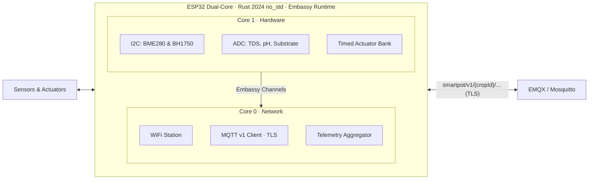

# SmartPot-IoT-Rust

[](https://github.com/SmartPotTech/SmartPot-IoT-Rust/actions/workflows/ci.yml)

[English](#english) | [Español](#español)

---

## English

### Overview

`SmartPot-IoT-Rust` is the **high-performance Rust firmware** for physical crop devices in the SmartPot platform. Written in Rust 2024 under a strict `no_std` environment, it leverages the **ESP32** dual-core architecture and the **Embassy** cooperative async runtime to deliver maximum speed, reliability, and memory safety without heavy dynamic allocators.

The device acquires readings across 7 physical variables (I2C and ADC), publishes telemetry under the SmartPot MQTT v1 contract (JSON v1 or 27-byte compact binary v2), executes remote commands with async timers, and emits acknowledgements (ACK) with human-readable English messages.



### Key Features

* **Rust 2024 `no_std`**: Native microcontroller code without standard library overhead or runtime memory fragmentation risk.
* **Embassy Async Runtime**: Cooperative task execution and lock-free static `PubSub` channels for inter-core communication.
* **Dual-Core Isolation**: Core 0 dedicated to the Wi-Fi network stack and MQTT v1 link; Core 1 dedicated to sensor sampling and real-time actuator control.
* **Full MQTT v1 Contract**: Strict compliance with topics, retained LWT (`offline` / `online`), null-free telemetry, and English ACK confirmations.
* **Strong Types & Memory Safety**: Zero-allocation serialization and deserialization (`heapless`), rejecting invalid commands with typed ACKs.
* **Native `demo-beta` Integration**: Fully compatible with the modern SmartPot stack (EMQX with HTTP authentication over `SmartPot-API-Go`, TimescaleDB, and SolidJS PWA).

### Pinout Assignment

| Component           | ESP32 Pin   | Type                       | Variable / Function                                   |
|---------------------|-------------|----------------------------|-------------------------------------------------------|
| **BME280** (SCL)    | GPIO 22     | Main I2C Bus (400 kHz)     | Shared I2C clock                                      |
| **BME280** (SDA)    | GPIO 21     | Main I2C Bus (400 kHz)     | `temperature` (°C), `humidity` (%), `atmosphere` (hPa)|
| **BH1750**          | I2C (22/21) | I2C (Address 0x23)         | `brightness` (lux)                                    |
| **TDS Sensor**      | GPIO 34     | ADC1 CH6 (11dB Attenuation)| `tds` (ppm)                                           |
| **pH Sensor**       | GPIO 35     | ADC1 CH7 (11dB Attenuation)| `ph` (0.00 – 14.00)                                   |
| **Soil Moisture**   | GPIO 32     | ADC1 CH4 (11dB Attenuation)| `soilMoisture` (%)                                    |
| **Water Pump**      | GPIO 25     | Digital Output             | `WATER_PUMP`                                          |
| **Grow Lights**     | GPIO 26     | Digital Output             | `LIGHTS`                                              |
| **Fan**             | GPIO 27     | Digital Output             | `FAN`                                                 |
| **Humidifier**      | GPIO 5      | Digital Output             | `HUMIDIFIER`                                          |

### MQTT v1 Contract

Canonical prefix: `smartpot/v1/{cropId}/`

| Topic              | Direction       | QoS | Retained | Purpose                                  | Payload / JSON Example                                                                                              |
|--------------------|-----------------|-----|----------|------------------------------------------|---------------------------------------------------------------------------------------------------------------------|
| `.../status`       | Device → Broker | 1   | Yes      | Crop status (LWT & connection)           | `"online"` / `"offline"`                                                                                            |
| `.../telemetry`    | Device → Broker | 0   | No       | Aggregated sample of physical variables  | `{"temperature":23.4,"humidity":64.8,"brightness":1850,"ph":6.85,"tds":620,"atmosphere":1012.8,"soilMoisture":48.2}`|
| `.../commands`     | API → Device    | 1   | No       | Actuation command with optional duration | `{"id":"cmd-1","actuator":"WATER_PUMP","action":"ACTIVATE","durationSeconds":15}`                                   |
| `.../commands/ack` | Device → Broker | 1   | No       | Execution confirmation in English        | `{"id":"cmd-1","status":"EXECUTED","message":"Water pump turned on for 15 s"}`                                      |

### Build Profiles & Commands

```bash
# Syntax and type check
cargo +esp check --ignore-rust-version

# Build executable binary
cargo +esp build --bin smartpot-iot --ignore-rust-version

# Flash to physical ESP32 board and open defmt serial monitor
espflash flash target/xtensa-esp32-none-elf/debug/smartpot-iot --monitor
```

### Integration Testing with `demo-beta`

```bash
uv run --with paho-mqtt python tests/verify_contract_v1.py
```

### Full Documentation

* [Complete SmartPot-IoT-Rust Documentation](docs/SmartPot_IoT_Rust_Documentation.md)

---

## Español

### Descripción

`SmartPot-IoT-Rust` es el **firmware de alto rendimiento en Rust** para el dispositivo de un cultivo real en la plataforma SmartPot. Diseñado en Rust 2024 bajo un entorno estricto `no_std`, aprovecha la arquitectura de doble núcleo (Dual-Core) del **ESP32** y el runtime asíncrono cooperativo **Embassy** para garantizar máxima velocidad, confiabilidad y seguridad de memoria sin depender de asignadores dinámicos pesados.

El dispositivo adquiere lecturas de 7 variables físicas (I2C y ADC), publica telemetría bajo el contrato MQTT v1 de SmartPot, ejecuta comandos remotos con temporizadores asíncronos y emite confirmaciones (ACK) con mensajes legibles en inglés.

### Características Principales

* **Rust 2024 `no_std`**: Código nativo para microcontroladores sin sobrecoste de biblioteca estándar ni riesgo de fragmentación de memoria en tiempo de ejecución.
* **Embassy Async Runtime**: Ejecución cooperativa de tareas y canales `PubSub` estáticos sin bloqueos (lock-free) para comunicación inter-núcleos.
* **Aislamiento Dual-Core**: Core 0 dedicado al stack de red WiFi y enlace MQTT v1; Core 1 dedicado al muestreo de sensores y control en tiempo real de actuadores.
* **Contrato MQTT v1 Completo**: Cumplimiento riguroso de tópicos, LWT retenido (`offline` / `online`), telemetría sin valores nulos y confirmaciones ACK en inglés.
* **Seguridad y Tipos Fuertes**: Serialización y deserialización sin asignaciones dinámicas (`heapless`), rechazando comandos inválidos con ACKs tipados.
* **Integración Nativa con `demo-beta`**: Totalmente compatible con la pila moderna de SmartPot (EMQX con autenticación HTTP sobre `SmartPot-API-Go`, TimescaleDB y SolidJS PWA).

### Asignación de Pines (Pinout)

| Componente | Pin ESP32 | Tipo | Variable / Función |
| --- | --- | --- | --- |
| **BME280** (SCL) | GPIO 22 | I2C Bus Principal (400 kHz) | Reloj I2C compartido |
| **BME280** (SDA) | GPIO 21 | I2C Bus Principal (400 kHz) | `temperature` (°C), `humidity` (%), `atmosphere` (hPa) |
| **BH1750** | I2C (22/21) | I2C (Dirección 0x23) | `brightness` (lux) |
| **Sensor TDS** | GPIO 34 | ADC1 CH6 (Atenuación 11dB) | `tds` (ppm) |
| **Sensor pH** | GPIO 35 | ADC1 CH7 (Atenuación 11dB) | `ph` (0.00 – 14.00) |
| **Humedad Sustrato** | GPIO 32 | ADC1 CH4 (Atenuación 11dB) | `soilMoisture` (%) |
| **Bomba de Agua** | GPIO 25 | Salida Digital | `WATER_PUMP` |
| **Luces de Cultivo** | GPIO 26 | Salida Digital | `LIGHTS` |
| **Ventilador** | GPIO 27 | Salida Digital | `FAN` |
| **Humidificador** | GPIO 5 | Salida Digital | `HUMIDIFIER` |

### Contrato MQTT v1

Prefijo canónico: `smartpot/v1/{cropId}/`

| Tópico | Sentido | QoS | Retenido | Propósito | Carga / Ejemplo JSON |
| --- | --- | --- | --- | --- | --- |
| `.../status` | Dispositivo → Broker | 1 | Sí | Estado del cultivo (LWT y conexión) | `"online"` / `"offline"` |
| `.../telemetry` | Dispositivo → Broker | 0 | No | Muestra agregada de variables físicas | `{"temperature":23.4,"humidity":64.8,"brightness":1850,"ph":6.85,"tds":620,"atmosphere":1012.8,"soilMoisture":48.2}` |
| `.../commands` | API → Dispositivo | 1 | No | Orden de actuación con duración opcional | `{"id":"cmd-1","actuator":"WATER_PUMP","action":"ACTIVATE","durationSeconds":15}` |
| `.../commands/ack` | Dispositivo → Broker | 1 | No | Confirmación de ejecución en inglés | `{"id":"cmd-1","status":"EXECUTED","message":"Water pump turned on for 15 s"}` |

### Compilación y Grabación

```bash
# Verificación de sintaxis y tipos
cargo +esp check --ignore-rust-version

# Compilación del binario ejecutable
cargo +esp build --bin smartpot-iot --ignore-rust-version

# Grabación en placa física ESP32 y monitor serie defmt
espflash flash target/xtensa-esp32-none-elf/debug/smartpot-iot --monitor
```

### Pruebas de Integración con `demo-beta`

```bash
uv run --with paho-mqtt python tests/verify_contract_v1.py
```

### Documentación Completa

* [Documentación Completa de SmartPot-IoT-Rust](docs/SmartPot_IoT_Rust_Documentation.md)
