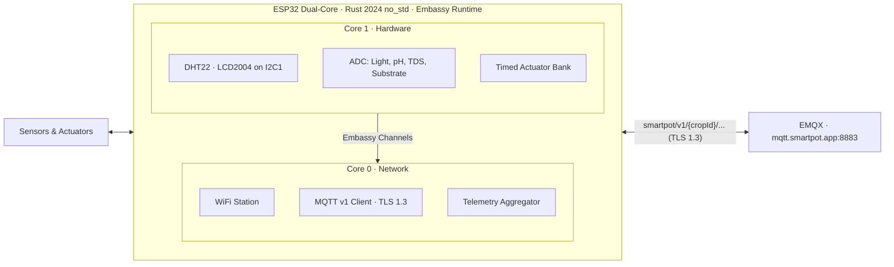

# SmartPot-IoT

[](https://github.com/SmartPotTech/SmartPot-IoT/actions/workflows/ci.yml)

[English](#english) | [Español](#español)

---

## English

### Overview

`SmartPot-IoT-Rust` is the **high-performance Rust firmware** for physical crop devices in the SmartPot platform.
Written in Rust 2024 under a strict `no_std` environment, it leverages the **ESP32** dual-core architecture and the *
*Embassy** cooperative async runtime to deliver maximum speed, reliability, and memory safety without heavy dynamic
allocators.

The device acquires readings across 7 physical variables (I2C and ADC), publishes telemetry under the SmartPot MQTT v1
contract (JSON v1 or 27-byte compact binary v2), executes remote commands with async timers, and emits
acknowledgements (ACK) with human-readable English messages.



### Key Features

* **Rust 2024 `no_std`**: Native microcontroller code without standard library overhead or runtime memory fragmentation
  risk.
* **Embassy Async Runtime**: Cooperative task execution and lock-free static `PubSub` channels for inter-core
  communication.
* **Dual-Core Isolation**: Core 0 dedicated to the Wi-Fi network stack and MQTT v1 link; Core 1 dedicated to sensor
  sampling and real-time actuator control.
* **Full MQTT v1 Contract**: Strict compliance with topics, retained LWT (`offline` / `online`), retained schema 1
  capabilities, null-free telemetry, and English ACK confirmations.
* **Strong Types & Memory Safety**: Zero-allocation serialization and deserialization (`heapless`), rejecting invalid
  commands with typed ACKs.
* **Native Production Stack B Integration**: Fully compatible with the modern SmartPot stack (EMQX with HTTP
  authentication over `SmartPot-API`, TimescaleDB, and SolidJS PWA). Note: for quick software-only prototyping or Wokwi
  simulation, refer to the [SmartPot-IoT-Python](https://github.com/SmartPotTech/SmartPot-IoT-Python) MicroPython
  companion.

### Pinout Assignment

By default the firmware uses **the same board as SmartPot-IoT-Python**: both repositories share a byte-identical
`diagram.json`, the same `config.json` format, and the same console and LCD output, so the two firmwares look the same
from outside. Filtering, the compact v2 packet, the watchdog and the rest of the internals stay specific to this
firmware.

| Component                   | ESP32 pin                | Contract field / actuator          |
|-----------------------------|--------------------------|------------------------------------|
| DHT22                       | GPIO 15                  | `temperature` (°C), `humidity` (%) |
| Light potentiometer         | GPIO 34 (0..2000 lux)    | `brightness`                       |
| pH potentiometer            | GPIO 35 (0..14)          | `ph`                               |
| TDS potentiometer           | GPIO 32 (0..3000 ppm)    | `tds`                              |
| Soil moisture potentiometer | GPIO 33 (0..100 %)       | `soilMoisture`                     |
| Water pump                  | GPIO 19                  | `WATER_PUMP`                       |
| UV light                    | GPIO 18                  | `UV_LIGHT`                         |
| Fan                         | GPIO 5                   | `FAN`                              |
| LCD2004 (I2C, 0x27)         | SCL GPIO 16, SDA GPIO 17 | local display                      |

The previous physical prototype (three BME280 behind a TCA9548A at 0x70 on SDA GPIO21 / SCL GPIO22, a BH1750, real TDS
and pH curves, the pump on GPIO25, UV light on GPIO26, fan on GPIO27 and humidifier on GPIO5) is still available with
`--features board-physical`.

**Configuration**: copy `config.example.json` to `config.json` (untracked). It has the same `WIFI`, `SMARTPOT` and
`BROKER.CA_CRT` blocks as the MicroPython firmware and is read at build time; environment variables with the names in
`.env.example` override single values.

### MQTT v1 Contract

Canonical prefix: `smartpot/v1/{cropId}/`

| Topic              | Direction       | QoS | Retained | Purpose                                                                                                                                | Payload / JSON Example                                                                                                                                                                                                |
|--------------------|-----------------|-----|----------|----------------------------------------------------------------------------------------------------------------------------------------|-----------------------------------------------------------------------------------------------------------------------------------------------------------------------------------------------------------------------|
| `.../status`       | Device → Broker | 1   | Yes      | Crop status (LWT & connection)                                                                                                         | `"online"` / `"offline"`                                                                                                                                                                                              |
| `.../capabilities` | Device → Broker | 1   | Yes      | Hardware declaration, published after `online` and before `commands`; 6 sensors and 3 actuators (7 and 4 with `board-physical`), <2 KB | `{"schema":1,"device":{"firmware":"smartpot-iot/0.1.0","hardware":"esp32-devkit-c-v4","telemetry":{"formats":["json-v1","compact-v2"],"compactBytes":27}},"sensors":[…],"actuators":["WATER_PUMP","UV_LIGHT","FAN"]}` |
| `.../telemetry`    | Device → Broker | 0   | No       | Aggregated sample of physical variables                                                                                                | `{"temperature":23.4,"humidity":64.8,"brightness":1850,"ph":6.85,"tds":620,"atmosphere":1012.8,"soilMoisture":48.2}`                                                                                                  |
| `.../commands`     | API → Device    | 1   | No       | Actuation command with optional duration                                                                                               | `{"id":"cmd-1","actuator":"WATER_PUMP","action":"ACTIVATE","durationSeconds":15}`                                                                                                                                     |
| `.../commands/ack` | Device → Broker | 1   | No       | Execution confirmation in English                                                                                                      | `{"id":"cmd-1","status":"EXECUTED","message":"Water pump turned on for 15 s"}`                                                                                                                                        |

### v2 Packet, Edge Filtering and Secure TLS

* **Compact telemetry v2**: optional 27-byte big-endian packet (magic `0x50`, version 2, sequence, SNTP epoch, 16-bit
  presence mask, seven fixed fields, CRC-8) published on the same `telemetry` topic when built with `COMPACT_TELEMETRY`.
  Ranges match the API; an absent, non-finite or out-of-range value clears its presence bit and leaves zero bytes
  instead of saturating the packet.
* **Deterministic rounding**: every scaled field uses symmetric `libm::roundf` (half away from zero), so the firmware
  and the API agree on boundary values.
* **Edge filtering**: each channel runs a median-of-5 window followed by a 1D Kalman filter in Q16.16 with a 3σ
  innovation gate. Spikes keep the estimate and expand the covariance, so a real step is accepted after a few samples
  instead of being locked out.
* **Atomic I2C multiplexing and sensor timing** (`board-physical`): the TCA9548A driver selects the channel inside the
  same bus lock as `write`, `write_read` and `transaction`, so concurrent BME280 reads cannot cross channels. The BME280
  driver waits 2 ms after reset and polls the measuring bit with a 20 ms cap.
* **CA-verified TLS 1.3**: `embedded-tls` verifies the broker chain against `CA_CERT_PEM` using the SNTP epoch. A
  missing or invalid CA, or an unsynchronized clock, fails closed: the firmware retries instead of falling back to an
  unverified connection.
* **Command safety**: the last 16 command ids are cached with their ACK; a QoS 1 redelivery repeats the stored ACK
  without toggling a pin. `UV_LIGHT` is canonical and `LIGHTS` is accepted as a legacy alias. `PH_DOSER` and
  `NUTRIENT_DOSER` parse correctly but return a descriptive `FAILED` ACK because this board has no GPIO for them.
* **Tests**: host tests cover the codec, filters, protocol, capabilities and configuration (
  `cargo test --manifest-path tests/host/Cargo.toml`); CI also runs formatting and the ESP32 feature matrix (
  `cargo +esp check`).

### Build-time Environment

The firmware reads its configuration at compile time with `option_env!`. `.env.example` is only a template: exporting it
does not configure a build by itself, and every variable must be present in the environment that runs
`cargo +esp build` (or in the launcher or CI secrets).

| Variable      | Purpose                                                            | Default when absent  |
|---------------|--------------------------------------------------------------------|----------------------|
| `BROKER_PORT` | MQTT broker port; invalid values fall back to `8883`               | `8883`               |
| `USE_TLS`     | `1`/`true`/`yes` enable TLS; `0`/`false`/`no` disable it           | enabled              |
| `CA_CERT_PEM` | PEM CA that signs the broker chain; required when TLS is enabled   | empty (fails closed) |
| `SNTP_SERVER` | SNTP server used to obtain the Unix epoch before the TLS handshake | `pool.ntp.org`       |

Rebuild after changing any value. The other provisioning variables (`SSID`, `PASSWORD`, `CROP_ID`, `DEVICE_KEY`,
`BROKER_HOST`, `COMPACT_TELEMETRY`) use the same mechanism.

### Build Profiles & Commands

```bash
# Syntax and type check
cargo +esp check --ignore-rust-version

# Build executable binary
cargo +esp build --bin smartpot-iot --ignore-rust-version

# Flash to physical ESP32 board and open the serial monitor (plain-text logs)
espflash flash target/xtensa-esp32-none-elf/debug/smartpot-iot --monitor
```

### Integration Testing with Local Demo

```bash
uv run --with paho-mqtt python tests/verify_contract_v1.py
```

### Wokwi Simulation

`diagram.json` is the MicroPython board described above (identical in both repositories). The DHT22, the four
potentiometers, the actuator LEDs and the LCD2004 are all simulated; the console prints the same reading table and
messages as the MicroPython firmware. Internal `[INFO ]`/`[WARN ]` logs are only printed with `--features verbose-logs`.

### Reliability and Actuator Safety

* **Actuator safety policy** (shared with the MicroPython firmware and the contract fixture): `durationSeconds` must be
  an integer between 1 and 3600, otherwise the command is rejected with a `FAILED` ACK and its reason. The water pump
  and the humidifier never run without a limit: `ACTIVATE` without a duration uses 3600 s, and both switch off after
  300 s without a broker session. The UV light and the fan keep indefinite activation.
* **Watchdog and fatal errors**: `esp_hal::init` disables every watchdog, so a supervisor task re-arms the RTC watchdog
  and feeds it only while every critical task keeps beating. A stalled task, a panic or a CPU exception turns every
  actuator off, prints `SMARTPOT-FATAL` and restarts the chip.
* **Network**: open networks (empty `PASSWORD`) are joined with open authentication; Wi-Fi and MQTT retries use
  exponential backoff with jitter (2 s to 60 s). MQTT pings the broker every 30 s, uses a 90 s TCP timeout and a 1 KiB
  maximum packet size, and discards telemetry queued while offline. TLS keeps a 4 KiB buffer for the broker chain
  (server certificate plus RSA 4096 CA).
* **Sensors**: the median + Kalman cascade reseeds after three consecutive rejections, so real steps (watering, lamps)
  show up within a minute, and light is filtered in tens of lux to avoid Q16.16 clipping. Readings older than three
  sampling periods are omitted, probes stuck at an ADC rail are dropped and the ADC is oversampled 16 times. With
  `board-physical`, the three BME280 units are averaged and I2C transactions and measurements have timeouts with
  BME280 hot-plug recovery.
* **Local display**: an LCD2004 on its own I2C bus (I2C1, SCL GPIO16 / SDA GPIO17) shows the same four rows as the
  MicroPython firmware (plus the humidifier flag with `board-physical`). A missing or failing LCD never affects sensors
  or telemetry.
* **Plain-text markers** for monitors and automated tests: `SMARTPOT-READY`, `WIFI-UP`, `TLS-OK`, `MQTT-UP`,
  `MQTT-REFUSED`, `MQTT-DOWN`, `ACT`, `ACK`, `LCD`, `HEAP` and `FATAL`.

Additional build-time variables: `TELEMETRY_INTERVAL_SECS`, `SENSOR_INTERVAL_SECS`, `OFFLINE_CUTOFF_SECS`,
`WATCHDOG_TIMEOUT_SECS`, `LIVENESS_TIMEOUT_SECS`, `HEAP_LOG_SECS`, `HEAP_MIN_FREE`, `ACTUATOR_ACTIVE_LOW=1` (relay
boards that switch on with a low input), `PH_NEUTRAL_MV`, `PH_SLOPE_MV`, `SOIL_DRY_RAW` and `SOIL_WET_RAW` (the last
four only with `board-physical`). GPIO5 (fan, or humidifier with `board-physical`) is a strapping pin that toggles at
boot: add a pull-down on the relay input.

### Automated Simulation Tests

`cargo +esp build --features sim` adds a serial command injector (JSON command lines on UART0) and test hooks.
`python tests/wokwi/run.py` builds it with short intervals and runs the scenarios in `tests/wokwi/` with `wokwi-cli`
(needs `WOKWI_CLI_TOKEN`): boot smoke test, actuator commands and safety policy, panic recovery and both watchdog paths.
The *Wokwi simulation* workflow runs them on demand. Wokwi applies the TIMG interrupt mask that the ESP32 silicon
ignores, so the firmware enables it at boot; without it Embassy time never advanced in the simulator.

### Full Documentation

* [Complete SmartPot-IoT-Rust Documentation](docs/SmartPot_IoT_Rust_Documentation.md)
* [Interactive diagrams](docs/diagrams/interactive/README.md#english): sensor filtering pipeline and command lifecycle,
  in English and Spanish, with links to the exact source lines

---

## Español

### Descripción

`SmartPot-IoT-Rust` es el **firmware de alto rendimiento en Rust** para el dispositivo de un cultivo real en la
plataforma SmartPot. Diseñado en Rust 2024 bajo un entorno estricto `no_std`, aprovecha la arquitectura de doble
núcleo (Dual-Core) del **ESP32** y el runtime asíncrono cooperativo **Embassy** para garantizar máxima velocidad,
confiabilidad y seguridad de memoria sin depender de asignadores dinámicos pesados.

El dispositivo adquiere lecturas de 7 variables físicas (I2C y ADC), publica telemetría bajo el contrato MQTT v1 de
SmartPot, ejecuta comandos remotos con temporizadores asíncronos y emite confirmaciones (ACK) con mensajes legibles en
inglés.

### Características Principales

* **Rust 2024 `no_std`**: Código nativo para microcontroladores sin sobrecoste de biblioteca estándar ni riesgo de
  fragmentación de memoria en tiempo de ejecución.
* **Embassy Async Runtime**: Ejecución cooperativa de tareas y canales `PubSub` estáticos sin bloqueos (lock-free) para
  comunicación inter-núcleos.
* **Aislamiento Dual-Core**: Core 0 dedicado al stack de red WiFi y enlace MQTT v1; Core 1 dedicado al muestreo de
  sensores y control en tiempo real de actuadores.
* **Contrato MQTT v1 Completo**: Cumplimiento riguroso de tópicos, LWT retenido (`offline` / `online`), capacidades
  retenidas con esquema 1, telemetría sin valores nulos y confirmaciones ACK en inglés.
* **Seguridad y Tipos Fuertes**: Serialización y deserialización sin asignaciones dinámicas (`heapless`), rechazando
  comandos inválidos con ACKs tipados.
* **Integración Nativa con Stack B en Producción**: Totalmente compatible con la pila moderna de SmartPot (EMQX con
  autenticación HTTP sobre `SmartPot-API`, TimescaleDB y SolidJS PWA). Para prototipado rápido en software o simulación
  en Wokwi, consulta el compañero
  MicroPython [SmartPot-IoT-Python](https://github.com/SmartPotTech/SmartPot-IoT-Python).

### Asignación de Pines (Pinout)

Por defecto el firmware usa **la misma placa que SmartPot-IoT-Python**: los dos repositorios comparten un `diagram.json`
idéntico byte a byte, el mismo formato de `config.json` y la misma salida de consola y de LCD, así que desde fuera los
dos firmwares se ven iguales. El filtrado, el paquete compacto v2, el watchdog y el resto de detalles internos siguen
siendo propios de este firmware.

| Componente                     | Pin del ESP32            | Campo del contrato / actuador      |
|--------------------------------|--------------------------|------------------------------------|
| DHT22                          | GPIO 15                  | `temperature` (°C), `humidity` (%) |
| Potenciómetro de luz           | GPIO 34 (0..2000 lux)    | `brightness`                       |
| Potenciómetro de pH            | GPIO 35 (0..14)          | `ph`                               |
| Potenciómetro de TDS           | GPIO 32 (0..3000 ppm)    | `tds`                              |
| Potenciómetro de humedad suelo | GPIO 33 (0..100 %)       | `soilMoisture`                     |
| Bomba de agua                  | GPIO 19                  | `WATER_PUMP`                       |
| Luz UV                         | GPIO 18                  | `UV_LIGHT`                         |
| Ventilador                     | GPIO 5                   | `FAN`                              |
| LCD2004 (I2C, 0x27)            | SCL GPIO 16, SDA GPIO 17 | pantalla local                     |

El prototipo físico anterior (tres BME280 tras un TCA9548A en 0x70 sobre SDA GPIO21 / SCL GPIO22, un BH1750, curvas
reales de TDS y pH, bomba en GPIO25, luz UV en GPIO26, ventilador en GPIO27 y humidificador en GPIO5) sigue disponible
con `--features board-physical`.

**Configuración**: copia `config.example.json` como `config.json` (no se versiona). Tiene los mismos bloques `WIFI`,
`SMARTPOT` y `BROKER.CA_CRT` que el firmware MicroPython y se lee al compilar; las variables de entorno con los nombres
de `.env.example` sobrescriben valores sueltos.

### Contrato MQTT v1

Prefijo canónico: `smartpot/v1/{cropId}/`

| Tópico             | Sentido              | QoS | Retenido | Propósito                                                                                                                             | Carga / Ejemplo JSON                                                                                                                                                                                                  |
|--------------------|----------------------|-----|----------|---------------------------------------------------------------------------------------------------------------------------------------|-----------------------------------------------------------------------------------------------------------------------------------------------------------------------------------------------------------------------|
| `.../status`       | Dispositivo → Broker | 1   | Sí       | Estado del cultivo (LWT y conexión)                                                                                                   | `"online"` / `"offline"`                                                                                                                                                                                              |
| `.../capabilities` | Dispositivo → Broker | 1   | Sí       | Declaración de hardware, publicada tras `online` y antes de `commands`; 6 sensores y 3 actuadores (7 y 4 con `board-physical`), <2 KB | `{"schema":1,"device":{"firmware":"smartpot-iot/0.1.0","hardware":"esp32-devkit-c-v4","telemetry":{"formats":["json-v1","compact-v2"],"compactBytes":27}},"sensors":[…],"actuators":["WATER_PUMP","UV_LIGHT","FAN"]}` |
| `.../telemetry`    | Dispositivo → Broker | 0   | No       | Muestra agregada de variables físicas                                                                                                 | `{"temperature":23.4,"humidity":64.8,"brightness":1850,"ph":6.85,"tds":620,"atmosphere":1012.8,"soilMoisture":48.2}`                                                                                                  |
| `.../commands`     | API → Dispositivo    | 1   | No       | Orden de actuación con duración opcional                                                                                              | `{"id":"cmd-1","actuator":"WATER_PUMP","action":"ACTIVATE","durationSeconds":15}`                                                                                                                                     |
| `.../commands/ack` | Dispositivo → Broker | 1   | No       | Confirmación de ejecución en inglés                                                                                                   | `{"id":"cmd-1","status":"EXECUTED","message":"Water pump turned on for 15 s"}`                                                                                                                                        |

### Paquete v2, filtrado en el borde y TLS seguro

* **Telemetría compacta v2**: paquete opcional de 27 bytes en big-endian (magic `0x50`, versión 2, secuencia, época
  SNTP, máscara de presencia de 16 bits, siete campos fijos y CRC-8) que se publica en el mismo tópico `telemetry` al
  compilar con `COMPACT_TELEMETRY`. Los rangos coinciden con los de la API; un valor ausente, no finito o fuera de rango
  deja su bit de presencia en cero y sus bytes en cero, sin saturar el paquete.
* **Redondeo determinista**: cada campo escalado usa `libm::roundf` de forma simétrica (mitad fuera de cero), así el
  firmware y la API coinciden en los valores límite.
* **Filtrado en el borde**: cada canal pasa por una ventana de mediana de 5 muestras y luego por un filtro de Kalman 1D
  en Q16.16 con puerta de innovación de 3σ. Un pico conserva la estimación y expande la covarianza, de modo que un
  cambio real se acepta tras unas pocas muestras en vez de quedar bloqueado.
* **Multiplexación I2C atómica y tiempos del sensor** (`board-physical`): el driver TCA9548A selecciona el canal dentro
  del mismo bloqueo de bus que `write`, `write_read` y `transaction`, así dos lecturas concurrentes de BME280 no cruzan
  canales. El driver BME280 espera 2 ms tras el reset y sondea el bit de medición con un tope de 20 ms.
* **TLS 1.3 con CA verificada**: `embedded-tls` verifica la cadena del broker contra `CA_CERT_PEM` usando la época SNTP.
  Si falta la CA, es inválida o el reloj no está sincronizado, el cliente falla cerrado: reintenta y nunca cae a una
  conexión sin verificar.
* **Seguridad de comandos**: se guardan los últimos 16 ids de comando con su ACK; una reentrega QoS 1 repite el ACK
  guardado sin accionar un pin. `UV_LIGHT` es el nombre canónico y `LIGHTS` se acepta como alias heredado. `PH_DOSER` y
  `NUTRIENT_DOSER` se parsean correctamente, pero devuelven un ACK `FAILED` descriptivo porque esta placa no tiene GPIO
  para ellos.
* **Pruebas**: las pruebas de host cubren el códec, los filtros, el protocolo, las capacidades y la configuración (
  `cargo test --manifest-path tests/host/Cargo.toml`); el CI también ejecuta formato y la matriz de features del ESP32 (
  `cargo +esp check`).

### Entorno de compilación

El firmware lee su configuración en tiempo de compilación con `option_env!`. `.env.example` es solo una plantilla:
exportarlo no configura una compilación por sí solo, y cada variable debe estar presente en el entorno que ejecuta
`cargo +esp build` (o en el lanzador o los secretos del CI).

| Variable      | Uso                                                              | Valor por defecto si falta |
|---------------|------------------------------------------------------------------|----------------------------|
| `BROKER_PORT` | Puerto del broker MQTT; un valor inválido vuelve a `8883`        | `8883`                     |
| `USE_TLS`     | `1`/`true`/`yes` activan TLS; `0`/`false`/`no` lo desactivan     | activado                   |
| `CA_CERT_PEM` | CA en PEM que firma la cadena del broker; obligatoria con TLS    | vacío (falla cerrado)      |
| `SNTP_SERVER` | Servidor SNTP para obtener la época Unix antes del handshake TLS | `pool.ntp.org`             |

Hay que recompilar tras cambiar cualquier valor. Las demás variables de aprovisionamiento (`SSID`, `PASSWORD`,
`CROP_ID`, `DEVICE_KEY`, `BROKER_HOST`, `COMPACT_TELEMETRY`) usan el mismo mecanismo.

### Compilación y Grabación

```bash
# Verificación de sintaxis y tipos
cargo +esp check --ignore-rust-version

# Compilación del binario ejecutable
cargo +esp build --bin smartpot-iot --ignore-rust-version

# Grabación en placa física ESP32 y monitor serie (registros en texto plano)
espflash flash target/xtensa-esp32-none-elf/debug/smartpot-iot --monitor
```

### Pruebas de Integración con Demo Local

```bash
uv run --with paho-mqtt python tests/verify_contract_v1.py
```

### Simulación en Wokwi

`diagram.json` es la placa de MicroPython descrita arriba (idéntica en los dos repositorios). Se simulan el DHT22, los
cuatro potenciómetros, los LED de los actuadores y el LCD2004; la consola imprime la misma tabla de lecturas y los
mismos
mensajes que el firmware MicroPython. Los registros internos `[INFO ]`/`[WARN ]` solo se imprimen con
`--features verbose-logs`.

### Fiabilidad y seguridad de actuadores

* **Política de actuadores** (compartida con el firmware MicroPython y con el fixture del contrato): `durationSeconds`
  debe ser un entero entre 1 y 3600; si no, el comando se rechaza con un ACK `FAILED` y su motivo. La bomba de agua y el
  humidificador nunca quedan encendidos sin límite: un `ACTIVATE` sin duración usa 3600 s y ambos se apagan tras 300 s
  sin sesión con el broker. La luz UV y el ventilador conservan el encendido indefinido.
* **Watchdog y errores fatales**: `esp_hal::init` desactiva todos los watchdogs, así que una tarea supervisora vuelve a
  armar el watchdog RTC y solo lo alimenta mientras todas las tareas críticas laten. Una tarea detenida, un pánico o una
  excepción de CPU apagan todos los actuadores, imprimen `SMARTPOT-FATAL` y reinician el chip.
* **Red**: las redes abiertas (`PASSWORD` vacío) se conectan con autenticación abierta; los reintentos de Wi-Fi y MQTT
  usan espera exponencial con dispersión (2 s a 60 s). MQTT envía PINGREQ cada 30 s, usa un tiempo límite TCP de 90 s y
  un paquete máximo de 1 KiB, y descarta la telemetría acumulada sin conexión. TLS reserva 4 KiB para la cadena del
  broker (certificado del servidor y CA RSA 4096).
* **Sensores**: la cascada mediana + Kalman se vuelve a sembrar tras tres rechazos seguidos, de modo que los cambios
  reales (un riego, una lámpara) aparecen en menos de un minuto, y la luz se filtra en decenas de lux para no saturar
  Q16.16. Las lecturas con más de tres periodos de muestreo se omiten, las sondas pegadas a un riel del ADC se
  descartan y el ADC se sobremuestrea 16 veces. Con `board-physical`, los tres BME280 se promedian y las transacciones
  I2C y las mediciones tienen tiempo límite, con reconexión en caliente del BME280.
* **Pantalla local**: un LCD2004 en su propio bus I2C (I2C1, SCL GPIO16 / SDA GPIO17) muestra las mismas cuatro filas
  que el firmware MicroPython (más el indicador del humidificador con `board-physical`). Un LCD ausente o averiado no
  afecta a los sensores ni a la telemetría.
* **Marcadores de texto** para monitores y pruebas automáticas: `SMARTPOT-READY`, `WIFI-UP`, `TLS-OK`, `MQTT-UP`,
  `MQTT-REFUSED`, `MQTT-DOWN`, `ACT`, `ACK`, `LCD`, `HEAP` y `FATAL`.

Variables de compilación adicionales: `TELEMETRY_INTERVAL_SECS`, `SENSOR_INTERVAL_SECS`, `OFFLINE_CUTOFF_SECS`,
`WATCHDOG_TIMEOUT_SECS`, `LIVENESS_TIMEOUT_SECS`, `HEAP_LOG_SECS`, `HEAP_MIN_FREE`, `ACTUATOR_ACTIVE_LOW=1` (módulos de
relé que se activan con nivel bajo), `PH_NEUTRAL_MV`, `PH_SLOPE_MV`, `SOIL_DRY_RAW` y `SOIL_WET_RAW` (las cuatro últimas
solo con `board-physical`). GPIO5 (ventilador, o humidificador con `board-physical`) es un pin de *strapping* que
conmuta al arrancar: conviene un *pull-down* en la entrada del relé.

### Pruebas automáticas en simulación

`cargo +esp build --features sim` añade un inyector de comandos por la consola serie (líneas JSON por UART0) y ganchos
de
prueba. `python tests/wokwi/run.py` lo compila con intervalos cortos y ejecuta las escenas de `tests/wokwi/` con
`wokwi-cli` (necesita `WOKWI_CLI_TOKEN`): arranque, comandos y política de seguridad de actuadores, recuperación tras un
pánico y las dos vías del watchdog. El workflow *Wokwi simulation* las ejecuta a demanda. Wokwi aplica la máscara de
interrupciones de TIMG que el silicio del ESP32 ignora, así que el firmware la habilita al arrancar; sin ella el tiempo
de
Embassy no avanzaba en el simulador.

### Documentación Completa

* [Documentación Completa de SmartPot-IoT-Rust](docs/SmartPot_IoT_Rust_Documentation.md)
* [Diagramas interactivos](docs/diagrams/interactive/README.md#español): la cadena de filtrado de los sensores y el
  ciclo de vida de un comando, en español e inglés, con enlaces a las líneas exactas del código
