<!-- portada
eyebrow: Component Documentation · Documentación del componente
titulo: SmartPot-IoT
acento: IoT
subtitulo: High-Performance Real Crop Firmware in Rust · Firmware de alto rendimiento para cultivo real en Rust
bajada: Rust 2024 no_std on dual-core ESP32 with Embassy: task-driven async architecture, lock-free channels, strict MQTT v1 contract over TLS, exact actuator timing, and 7-sensor physical telemetry. / Rust 2024 no_std sobre ESP32 dual-core con Embassy: arquitectura asíncrona por tareas, canales libres de bloqueo, contrato MQTT v1 estricto con TLS, temporización exacta de actuadores y telemetría de 7 variables físicas.
documento: SmartPot-IoT
version: 2.0 · November 2026 / noviembre 2026
equipo: SmartPotTech
proyecto: smartpot.app
-->

# SmartPot-IoT

[English](#english) | [Español](#español)

---

# English

## Document Sheet

| Field                  | Value                                                                                                                                                                                                                                                                                                                                                                                                                                           |
|------------------------|-------------------------------------------------------------------------------------------------------------------------------------------------------------------------------------------------------------------------------------------------------------------------------------------------------------------------------------------------------------------------------------------------------------------------------------------------|
| Project                | SmartPot · [smartpot.app](https://smartpot.app)                                                                                                                                                                                                                                                                                                                                                                                                 |
| Component              | [SmartPot-IoT](https://github.com/SmartPotTech/SmartPot-IoT)                                                                                                                                                                                                                                                                                                                                                                          |
| Version                | 2.0 · November 2026                                                                                                                                                                                                                                                                                                                                                                                                                              |
| Scope                  | Dual-core architecture, Embassy async runtime, MQTT v1 contract, timed actuator bank, I2C/ADC acquisition, and production stack integration                                                                                                                                                                                                                                                                                                         |
| Platform Documentation | [Technical Documentation](https://github.com/SmartPotTech/.github/blob/main/docs/SmartPot_Technical_Documentation.md), [Project Journey](https://github.com/SmartPotTech/.github/blob/main/docs/SmartPot_Project_Journey.md), [Software Lifecycle](https://github.com/SmartPotTech/.github/blob/main/docs/SmartPot_Software_Lifecycle.md), and [Global Diagrams](https://github.com/SmartPotTech/.github/blob/main/docs/README.md#diagramas-generales) |
| Maintenance            | Updated alongside hardware specifications and the platform MQTT contract                                                                                                                                                                                                                                                                                                                                                                        |

<!-- parte: PART I | The Component -->

## 1. Purpose

### In Simple Terms

`SmartPot-IoT-Rust` is the high-performance, high-reliability device firmware for physical crops in SmartPot. Compared to the MicroPython implementation, this Rust firmware maximizes ESP32 hardware capabilities through:
1. **Strict `no_std` environment**: Zero OS dependencies or runtime heap fragmentation.
2. **Async concurrency with Embassy**: Ultra-fast cooperative scheduling with microsecond latency and static RAM allocation.
3. **Dual-Core isolation**: Core 0 handles the network stack (Wi-Fi station, TLS 1.2+, and MQTT v1 client), while Core 1 is dedicated exclusively to sensor sampling (I2C and ADC) and physical actuator control.
4. **Memory safety & strong types**: The MQTT v1 contract is modeled with typed enums and structs (`Command`, `SensorState`, `AckMessage`), ensuring malformed messages never trigger an uncontrolled panic or reboot.

---

## 2. Component Architecture

```mermaid
%%{init: {"theme": "base", "fontFamily": "Segoe UI, Arial, sans-serif", "themeVariables": {"fontFamily": "Segoe UI, Arial, sans-serif", "fontSize": "15px", "primaryColor": "#DDF5EA", "primaryTextColor": "#17261F", "primaryBorderColor": "#067A52", "secondaryColor": "#E3F2FB", "secondaryTextColor": "#17261F", "secondaryBorderColor": "#1F6FA0", "tertiaryColor": "#F2F7F4", "tertiaryTextColor": "#17261F", "tertiaryBorderColor": "#D5E3DC", "lineColor": "#5B6B63", "textColor": "#17261F", "mainBkg": "#DDF5EA", "nodeBorder": "#067A52", "clusterBkg": "#F7FAF8", "clusterBorder": "#D5E3DC", "edgeLabelBackground": "#FFFFFF", "actorBkg": "#067A52", "actorBorder": "#0B3D2B", "actorTextColor": "#FFFFFF", "actorLineColor": "#5B6B63", "signalColor": "#17261F", "signalTextColor": "#17261F", "labelBoxBkgColor": "#0B3D2B", "labelBoxBorderColor": "#0B3D2B", "labelTextColor": "#FFFFFF", "loopTextColor": "#0B3D2B", "noteBkgColor": "#FDF4DD", "noteBorderColor": "#C98D12", "noteTextColor": "#17261F", "activationBkgColor": "#DDF5EA", "activationBorderColor": "#067A52", "attributeBackgroundColorOdd": "#FFFFFF", "attributeBackgroundColorEven": "#F2F7F4"}, "layout": "elk", "elk": {"nodePlacementStrategy": "BRANDES_KOEPF", "mergeEdges": false, "cycleBreakingStrategy": "GREEDY"}}}%%
flowchart LR
  subgraph esp["ESP32 Dual-Core · Rust 2024 no_std · Embassy Runtime"]
    direction TB
    subgraph core0["Core 0 · Network & Communications"]
      direction TB
      wifi["tasks/wifi.rs<br/>WiFi Station · Retries"]
      mqtt["tasks/mqtt.rs<br/>MQTT v1 Client · TLS 1.2+<br/>Retained LWT · select3 loop"]
      telem["tasks/telemetry.rs: telemetry_task<br/>Aggregation · SensorState"]
    end

    subgraph core1["Core 1 · Acquisition & Control"]
      direction TB
      i2c["tasks/sensors.rs: bme280 & bh1750<br/>Temperature, Humidity, Pressure, Lux"]
      adc["tasks/sensors.rs: analog_sensors<br/>TDS, pH, Substrate Moisture"]
      act["tasks/command.rs: catch_commands<br/>Pump, Lights, Fan, Humidifier<br/>Instant::now() + Duration Timer"]
    end

    subgraph channels["Lock-Free Static Embassy Channels"]
      direction TB
      sch["SENSOR_CH<br/>Physical measurements"]
      cch["COMMAND_CH<br/>Incoming commands"]
      ach["ACK_CH<br/>English ACK confirmations"]
      tch["TELEMETRY_CH<br/>Null-free v1/v2 payloads"]
    end
  end

  subgraph hw["Peripherals & Circuit"]
    direction TB
    sens["I2C SCL 22 / SDA 21<br/>ADC GPIO 34, 35, 32"]
    outs["Pump 25 · Lights 26<br/>Fan 27 · Humidifier 5"]
  end

  broker["EMQX Broker / Mosquitto<br/>mqtt.smartpot.app:8883"]

  sens --> i2c & adc
  act --> outs

  i2c & adc -->|"produces measurements"| sch
  sch -->|"consumes & aggregates"| telem
  telem -->|"emits v1 JSON / v2 binary"| tch
  tch -->|"publishes on bus"| mqtt

  mqtt <-->|"smartpot/v1/{cropId}/..."| broker
  mqtt -->|"dispatches valid command"| cch
  cch -->|"executes & times"| act
  act -->|"emits ACK"| ach
  ach -->|"publishes confirmation"| mqtt

  classDef leaf fill:#DDF5EA,stroke:#067A52,color:#17261F
  classDef water fill:#E3F2FB,stroke:#1F6FA0,color:#17261F
  classDef sun fill:#FDF4DD,stroke:#C98D12,color:#17261F
  classDef clay fill:#FBE9E1,stroke:#B85A38,color:#17261F
  classDef core fill:#067A52,stroke:#0B3D2B,color:#FFFFFF
  classDef deep fill:#0B3D2B,stroke:#06281C,color:#FFFFFF
  classDef muted fill:#F2F7F4,stroke:#5B6B63,color:#17261F
  class mqtt,act core
  class broker deep
```

<!-- diagrama: SmartPot_IoT_Rust_Global_Component | titulo=SmartPot-IoT-Rust Inside · SmartPot-IoT-Rust por dentro | lamina=H -->

---

## 3. Pinout and Peripherals

| Peripheral        | ESP32 Pin   | Function / Protocol        | Variable / Metric                                     |
|-------------------|-------------|----------------------------|-------------------------------------------------------|
| **BME280** (SCL)  | GPIO 22     | Main I2C Bus (400 kHz)     | Shared I2C clock                                      |
| **BME280** (SDA)  | GPIO 21     | Main I2C Bus (400 kHz)     | `temperature` (°C), `humidity` (%), `atmosphere` (hPa)|
| **BH1750**        | I2C (22/21) | I2C (Address 0x23)         | `brightness` (lux)                                    |
| **TDS Sensor**    | GPIO 34     | ADC1 CH6 (11dB Attenuation)| `tds` (ppm, temperature-compensated)                  |
| **pH Sensor**     | GPIO 35     | ADC1 CH7 (11dB Attenuation)| `ph` (0.00 – 14.00 scale)                             |
| **Soil Moisture** | GPIO 32     | ADC1 CH4 (11dB Attenuation)| `soilMoisture` (volumetric %)                         |
| **Water Pump**    | GPIO 25     | Digital Output (Push-Pull) | `WATER_PUMP`                                          |
| **Grow Lights**   | GPIO 26     | Digital Output (Push-Pull) | `LIGHTS`                                              |
| **Fan**           | GPIO 27     | Digital Output (Push-Pull) | `FAN`                                                 |
| **Humidifier**    | GPIO 5      | Digital Output (Push-Pull) | `HUMIDIFIER`                                          |

---

## 4. MQTT v1 Contract

The firmware communicates under the canonical prefix `smartpot/v1/{cropId}/`:

| Topic              | Direction       | QoS | Retained | Purpose                                  | Payload / JSON Example                                                                                              |
|--------------------|-----------------|-----|----------|------------------------------------------|---------------------------------------------------------------------------------------------------------------------|
| `.../status`       | Device → Broker | 1   | Yes      | Crop status (LWT & connection)           | `"online"` / `"offline"`                                                                                            |
| `.../telemetry`    | Device → Broker | 0   | No       | Aggregated sample of 7 physical variables| `{"temperature":23.4,"humidity":64.8,"brightness":1850,"ph":6.85,"tds":620,"atmosphere":1012.8,"soilMoisture":48.2}`|
| `.../commands`     | API → Device    | 1   | No       | Actuation command with optional duration | `{"id":"cmd-1","actuator":"WATER_PUMP","action":"ACTIVATE","durationSeconds":15}`                                   |
| `.../commands/ack` | Device → Broker | 1   | No       | Execution confirmation in English        | `{"id":"cmd-1","status":"EXECUTED","message":"Water pump turned on for 15 s"}`                                      |

---

## 5. Actuator Control and Async Timing

Each actuator holds an independent `ActuatorRuntime` state:
- **Continuous activation**: Sets the GPIO pin high and marks `active = true`, `until = None`.
- **Timed activation**: Sets the GPIO pin high and sets `until = Some(Instant::now() + Duration::from_secs(secs))`.
- **Supervision loop**: `catch_commands` inspects active deadlines every 250 ms and automatically turns off the digital pin when `Instant::now() >= until` without blocking incoming commands.

---

# Español

## Ficha del documento

| Campo | Valor |
| --- | --- |
| Proyecto | SmartPot · [smartpot.app](https://smartpot.app) |
| Componente | [SmartPot-IoT](https://github.com/SmartPotTech/SmartPot-IoT) |
| Versión | 2.0 · noviembre 2026 |
| Alcance | Arquitectura dual-core, Embassy async runtime, contrato MQTT v1, banco de actuadores temporizados, adquisición I2C/ADC e integración con el stack de producción |
| Documentación de la plataforma | [Documentación técnica](https://github.com/SmartPotTech/.github/blob/main/docs/SmartPot_Technical_Documentation.md), [recorrido del proyecto](https://github.com/SmartPotTech/.github/blob/main/docs/SmartPot_Project_Journey.md), [ciclo de vida](https://github.com/SmartPotTech/.github/blob/main/docs/SmartPot_Software_Lifecycle.md) y [diagramas generales](https://github.com/SmartPotTech/.github/blob/main/docs/README.md#diagramas-generales) |
| Mantenimiento | Se actualiza en conjunto con las especificaciones de hardware y el contrato MQTT de la plataforma |

<!-- parte: PARTE I | El componente -->

## 1. Propósito

### En palabras simples

`SmartPot-IoT-Rust` representa la evolución de alto rendimiento y máxima confiabilidad del firmware de dispositivo para cultivos reales en SmartPot. Frente a la implementación base en MicroPython, esta versión en Rust aprovecha al máximo el hardware del ESP32 mediante:
1. **Entorno `no_std` estricto**: Sin dependencias de sistema operativo pesado ni fragmentación de memoria dinámica en tiempo de ejecución.
2. **Concurrencia asíncrona con Embassy**: Despacho cooperativo ultrarrápido con microsegundos de latencia y uso óptimo de memoria RAM estática.
3. **Aislamiento en doble núcleo (Dual-Core)**: El Core 0 gestiona la pila de red (WiFi estación, TLS 1.2+ y cliente MQTT v1), mientras el Core 1 se dedica exclusivamente a la lectura de sensores (I2C y ADC) y al control de los actuadores físicos.
4. **Seguridad y tipos fuertes**: El contrato MQTT v1 se modela mediante enums y estructuras tipadas (`Command`, `SensorState`, `AckMessage`), garantizando que ningún mensaje mal formado cause un pánico o reinicio no controlado.

---

## 2. Arquitectura del componente

En el diagrama global (`SmartPot_IoT_Rust_Global_Component`), el Core 0 ejecuta la conectividad WiFi, el cliente MQTT v1 con TLS y el agregador de telemetría, mientras el Core 1 muestrea los sensores I2C/ADC y controla el banco de actuadores temporizados mediante canales estáticos libres de bloqueo.

---

## 3. Asignación de Pines y Periféricos

| Periférico | Pin ESP32 | Función / Protocolo | Variable / Métrica |
| --- | --- | --- | --- |
| **BME280** (SCL) | GPIO 22 | I2C Bus Principal (400 kHz) | Reloj I2C compartido |
| **BME280** (SDA) | GPIO 21 | I2C Bus Principal (400 kHz) | `temperature` (°C), `humidity` (%), `atmosphere` (hPa) |
| **BH1750** | I2C (22/21) | I2C (Dirección 0x23) | `brightness` (lux) |
| **Sensor TDS** | GPIO 34 | ADC1 Canal 6 (Atenuación 11dB) | `tds` (ppm, compensado) |
| **Sensor pH** | GPIO 35 | ADC1 Canal 7 (Atenuación 11dB) | `ph` (escala 0.00 – 14.00) |
| **Humedad Sustrato** | GPIO 32 | ADC1 Canal 4 (Atenuación 11dB) | `soilMoisture` (% volumétrico) |
| **Bomba de Agua** | GPIO 25 | Salida Digital (Push-Pull) | `WATER_PUMP` |
| **Luces de Cultivo** | GPIO 26 | Salida Digital (Push-Pull) | `LIGHTS` |
| **Ventilador** | GPIO 27 | Salida Digital (Push-Pull) | `FAN` |
| **Humidificador** | GPIO 5 | Salida Digital (Push-Pull) | `HUMIDIFIER` |

---

## 4. Contrato MQTT v1

El firmware se comunica bajo el prefijo canónico `smartpot/v1/{cropId}/`:

| Tópico | Sentido | QoS | Retenido | Propósito | Carga / Ejemplo JSON |
| --- | --- | --- | --- | --- | --- |
| `.../status` | Dispositivo → Broker | 1 | Sí | Estado del cultivo (LWT y conexión) | `"online"` / `"offline"` |
| `.../telemetry` | Dispositivo → Broker | 0 | No | Muestra agregada de 7 variables físicas | `{"temperature":23.4,"humidity":64.8,"brightness":1850,"ph":6.85,"tds":620,"atmosphere":1012.8,"soilMoisture":48.2}` |
| `.../commands` | API → Dispositivo | 1 | No | Orden de actuación con duración opcional | `{"id":"cmd-1","actuator":"WATER_PUMP","action":"ACTIVATE","durationSeconds":15}` |
| `.../commands/ack` | Dispositivo → Broker | 1 | No | Confirmación de ejecución en inglés | `{"id":"cmd-1","status":"EXECUTED","message":"Water pump turned on for 15 s"}` |

---

## 5. Control de Actuadores y Temporización Asíncrona

Cada actuador posee un estado independiente `ActuatorRuntime`:
- **Encendido permanente**: Se activa el pin GPIO en nivel alto y se marca `active = true`, `until = None`.
- **Encendido temporizado**: Se activa el pin GPIO en nivel alto y se establece `until = Some(Instant::now() + Duration::from_secs(secs))`.
- **Bucle de supervisión**: La tarea `catch_commands` inspecciona periódicamente los plazos activos. Cuando `Instant::now() >= until`, apaga automáticamente el pin digital sin bloquear la recepción de nuevas órdenes.
