<!-- portada
eyebrow: Component Documentation · Documentación del componente
titulo: SmartPot-IoT
acento: IoT
subtitulo: High-Performance Real Crop Firmware in Rust · Firmware de alto rendimiento para cultivo real en Rust
bajada: Rust 2024 no_std on dual-core ESP32 with Embassy: task-driven async architecture, lock-free channels, strict MQTT v1 contract over TLS, exact actuator timing, and 7-sensor physical telemetry. / Rust 2024 no_std sobre ESP32 dual-core con Embassy: arquitectura asíncrona por tareas, canales libres de bloqueo, contrato MQTT v1 estricto con TLS, temporización exacta de actuadores y telemetría de 7 variables físicas.
documento: SmartPot-IoT
version: 2.0 · November 2026 / noviembre 2026
equipo: SmartPotTech
proyecto: smartpot.app
-->

# SmartPot-IoT

[English](#english) | [Español](#español)

---

# English

## Document Sheet

| Field                  | Value                                                                                                                                                                                                                                                                                                                                                                                                                                           |
|------------------------|-------------------------------------------------------------------------------------------------------------------------------------------------------------------------------------------------------------------------------------------------------------------------------------------------------------------------------------------------------------------------------------------------------------------------------------------------|
| Project                | SmartPot · [smartpot.app](https://smartpot.app)                                                                                                                                                                                                                                                                                                                                                                                                 |
| Component              | [SmartPot-IoT](https://github.com/SmartPotTech/SmartPot-IoT)                                                                                                                                                                                                                                                                                                                                                                          |
| Version                | 2.0 · November 2026                                                                                                                                                                                                                                                                                                                                                                                                                              |
| Scope                  | Dual-core architecture, Embassy async runtime, MQTT v1 contract, compact v2 codec, edge filtering, CA-verified TLS 1.3, timed actuator bank, I2C/ADC acquisition, and production stack integration                                                                                                                                                                                                                                                    |
| Platform Documentation | [Technical Documentation](https://github.com/SmartPotTech/.github/blob/main/docs/SmartPot_Technical_Documentation.md), [Project Journey](https://github.com/SmartPotTech/.github/blob/main/docs/SmartPot_Project_Journey.md), [Software Lifecycle](https://github.com/SmartPotTech/.github/blob/main/docs/SmartPot_Software_Lifecycle.md), and [Global Diagrams](https://github.com/SmartPotTech/.github/blob/main/docs/README.md#diagramas-generales) |
| Maintenance            | Updated alongside hardware specifications and the platform MQTT contract                                                                                                                                                                                                                                                                                                                                                                        |

<!-- parte: PART I | The Component -->

## 1. Purpose

### In Simple Terms

`SmartPot-IoT-Rust` is the high-performance, high-reliability device firmware for physical crops in SmartPot. Compared to the MicroPython implementation, this Rust firmware maximizes ESP32 hardware capabilities through:
1. **Strict `no_std` environment**: Zero OS dependencies or runtime heap fragmentation.
2. **Async concurrency with Embassy**: Ultra-fast cooperative scheduling with microsecond latency and static RAM allocation.
3. **Dual-Core isolation**: Core 0 handles the network stack (Wi-Fi station, TLS 1.3, and MQTT v1 client), while Core 1 is dedicated exclusively to sensor sampling (I2C and ADC) and physical actuator control.
4. **Memory safety & strong types**: The MQTT v1 contract is modeled with typed enums and structs (`Command`, `SensorState`, `AckMessage`), ensuring malformed messages never trigger an uncontrolled panic or reboot.

---

## 2. Component Architecture

```mermaid
%%{init: {"theme": "base", "fontFamily": "Segoe UI, Arial, sans-serif", "themeVariables": {"fontFamily": "Segoe UI, Arial, sans-serif", "fontSize": "15px", "primaryColor": "#DDF5EA", "primaryTextColor": "#17261F", "primaryBorderColor": "#067A52", "secondaryColor": "#E3F2FB", "secondaryTextColor": "#17261F", "secondaryBorderColor": "#1F6FA0", "tertiaryColor": "#F2F7F4", "tertiaryTextColor": "#17261F", "tertiaryBorderColor": "#D5E3DC", "lineColor": "#5B6B63", "textColor": "#17261F", "mainBkg": "#DDF5EA", "nodeBorder": "#067A52", "clusterBkg": "#F7FAF8", "clusterBorder": "#D5E3DC", "edgeLabelBackground": "#FFFFFF", "actorBkg": "#067A52", "actorBorder": "#0B3D2B", "actorTextColor": "#FFFFFF", "actorLineColor": "#5B6B63", "signalColor": "#17261F", "signalTextColor": "#17261F", "labelBoxBkgColor": "#0B3D2B", "labelBoxBorderColor": "#0B3D2B", "labelTextColor": "#FFFFFF", "loopTextColor": "#0B3D2B", "noteBkgColor": "#FDF4DD", "noteBorderColor": "#C98D12", "noteTextColor": "#17261F", "activationBkgColor": "#DDF5EA", "activationBorderColor": "#067A52", "attributeBackgroundColorOdd": "#FFFFFF", "attributeBackgroundColorEven": "#F2F7F4"}, "layout": "elk", "elk": {"nodePlacementStrategy": "BRANDES_KOEPF", "mergeEdges": false, "cycleBreakingStrategy": "GREEDY"}}}%%
flowchart LR
  subgraph esp["ESP32 Dual-Core · Rust 2024 no_std · Embassy Runtime"]
    direction TB
    subgraph core0["Core 0 · Network & Communications"]
      direction TB
      wifi["tasks/wifi.rs<br/>WiFi Station · Retries"]
      mqtt["tasks/mqtt.rs<br/>MQTT v1 Client · TLS 1.3<br/>Retained LWT · select3 loop"]
      telem["tasks/telemetry.rs: telemetry_task<br/>Aggregation · SensorState"]
      caps["capabilities topic<br/>retained · schema 1<br/>7 sensors · 4 actuators"]
    end

    subgraph core1["Core 1 · Acquisition & Control"]
      direction TB
      i2c["tasks/sensors.rs: bme280 & bh1750<br/>Temperature, Humidity, Pressure, Lux<br/>median-5 + Q16.16 Kalman"]
      adc["tasks/sensors.rs: analog_sensors<br/>TDS, pH, Substrate Moisture"]
      act["tasks/command.rs: catch_commands<br/>Pump, UV Light (LIGHTS alias), Fan, Humidifier<br/>Instant::now() + Duration Timer"]
    end

    subgraph channels["Lock-Free Static Embassy Channels"]
      direction TB
      sch["SENSOR_CH<br/>Filtered physical measurements"]
      cch["COMMAND_CH<br/>Incoming commands"]
      ach["ACK_CH<br/>English ACK confirmations"]
      tch["TELEMETRY_CH<br/>v1 JSON / v2 27-byte packet"]
    end
  end

  subgraph hw["Peripherals & Circuit"]
    direction TB
    sens["I2C SCL 22 / SDA 21<br/>ADC GPIO 34, 35, 32"]
    outs["Pump 25 · UV 26<br/>Fan 27 · Humidifier 5"]
  end

  broker["SmartPot-Broker (EMQX)<br/>mqtt.smartpot.app:8883"]

  sens --> i2c & adc
  act --> outs

  i2c & adc -->|"produces measurements"| sch
  sch -->|"consumes & aggregates"| telem
  telem -->|"emits v1 JSON / v2 binary"| tch
  tch -->|"publishes on bus"| mqtt
  mqtt -->|"publishes retained at connect"| caps

  mqtt <-->|"smartpot/v1/{cropId}/..."| broker
  mqtt -->|"dispatches valid command"| cch
  cch -->|"executes & times"| act
  act -->|"emits ACK"| ach
  ach -->|"publishes confirmation"| mqtt

  classDef leaf fill:#DDF5EA,stroke:#067A52,color:#17261F
  classDef water fill:#E3F2FB,stroke:#1F6FA0,color:#17261F
  classDef sun fill:#FDF4DD,stroke:#C98D12,color:#17261F
  classDef clay fill:#FBE9E1,stroke:#B85A38,color:#17261F
  classDef core fill:#067A52,stroke:#0B3D2B,color:#FFFFFF
  classDef deep fill:#0B3D2B,stroke:#06281C,color:#FFFFFF
  classDef muted fill:#F2F7F4,stroke:#5B6B63,color:#17261F
  class mqtt,act core
  class broker deep
```

<!-- diagrama: SmartPot_IoT_Rust_Global_Component | titulo=SmartPot-IoT-Rust Inside · SmartPot-IoT-Rust por dentro | lamina=H -->

---

## 3. Pinout and Peripherals

| Peripheral        | ESP32 Pin   | Function / Protocol        | Variable / Metric                                     |
|-------------------|-------------|----------------------------|-------------------------------------------------------|
| **BME280** (SCL)  | GPIO 22     | Main I2C Bus (100 kHz)     | Shared I2C clock                                      |
| **BME280** (SDA)  | GPIO 21     | Main I2C Bus (100 kHz)     | `temperature` (°C), `humidity` (%), `atmosphere` (hPa)|
| **BH1750**        | I2C (22/21) | I2C (Address 0x23)         | `brightness` (lux)                                    |
| **TDS Sensor**    | GPIO 34     | ADC1 CH6 (11dB Attenuation)| `tds` (ppm, temperature-compensated)                  |
| **pH Sensor**     | GPIO 35     | ADC1 CH7 (11dB Attenuation)| `ph` (0.00 – 14.00 scale)                             |
| **Soil Moisture** | GPIO 32     | ADC1 CH4 (11dB Attenuation)| `soilMoisture` (volumetric %)                         |
| **Water Pump**    | GPIO 25     | Digital Output (Push-Pull) | `WATER_PUMP`                                          |
| **UV Light**      | GPIO 26     | Digital Output (Push-Pull) | `UV_LIGHT` (legacy alias: `LIGHTS`)                   |
| **Fan**           | GPIO 27     | Digital Output (Push-Pull) | `FAN`                                                 |
| **Humidifier**    | GPIO 5      | Digital Output (Push-Pull) | `HUMIDIFIER`                                          |

---

## 4. MQTT v1 Contract

The firmware communicates under the canonical prefix `smartpot/v1/{cropId}/`:

| Topic              | Direction       | QoS | Retained | Purpose                                  | Payload / JSON Example                                                                                              |
|--------------------|-----------------|-----|----------|------------------------------------------|---------------------------------------------------------------------------------------------------------------------|
| `.../status`       | Device → Broker | 1   | Yes      | Crop status (LWT & connection)           | `"online"` / `"offline"`                                                                                            |
| `.../capabilities` | Device → Broker | 1   | Yes      | Retained schema 1 declaration, published after `online` and before `commands`; 7 sensors, 4 actuators, <2 KB | `{"schema":1,"device":{"firmware":"smartpot-iot/0.1.0","telemetry":{"formats":["json-v1","compact-v2"],"compactBytes":27}},"sensors":[…],"actuators":["WATER_PUMP","UV_LIGHT","FAN","HUMIDIFIER"]}` |
| `.../telemetry`    | Device → Broker | 0   | No       | Aggregated sample of 7 physical variables| `{"temperature":23.4,"humidity":64.8,"brightness":1850,"ph":6.85,"tds":620,"atmosphere":1012.8,"soilMoisture":48.2}`|
| `.../commands`     | API → Device    | 1   | No       | Actuation command with optional duration | `{"id":"cmd-1","actuator":"WATER_PUMP","action":"ACTIVATE","durationSeconds":15}`                                   |
| `.../commands/ack` | Device → Broker | 1   | No       | Execution confirmation in English        | `{"id":"cmd-1","status":"EXECUTED","message":"Water pump turned on for 15 s"}`                                      |

---

## 5. Actuator Control and Async Timing

Each actuator holds an independent `ActuatorRuntime` state:
- **Continuous activation**: Sets the GPIO pin high and marks `active = true`, `until = None`.
- **Timed activation**: Sets the GPIO pin high and sets `until = Some(Instant::now() + Duration::from_secs(secs))`.
- **Supervision loop**: `catch_commands` inspects active deadlines every 250 ms and automatically turns off the digital pin when `Instant::now() >= until` without blocking incoming commands.

---

## 6. Compact Telemetry v2 and SNTP Epoch

Built with `COMPACT_TELEMETRY`, the firmware publishes a 27-byte big-endian packet on the same `.../telemetry` topic; the API accepts both this packet and the JSON v1 payload.

- `[0]` magic `0x50`, `[1]` version `2`, `[2..4]` sequence, `[4..8]` Unix epoch from SNTP (`0` when the clock is not synchronized).
- `[8..10]` 16-bit presence mask: temperature, humidity, brightness, pH, TDS, atmosphere and soil moisture.
- `[10..26]` fixed fields; `[26]` CRC-8 with polynomial `0x07`.
- Every scaled value uses symmetric `libm::roundf` (half away from zero) and is marked present only when the resulting integer falls inside the API range. Absent or out-of-range values clear their bit and leave zero bytes; the packet never saturates.
- The device skips the publish when the mask is zero. The JSON v1 path shares the same API ranges and omits absent fields.

The epoch is set by the SNTP task before the TLS handshake and advances monotonically with `embassy_time::Instant`; a later resynchronization never moves it backwards.

## 7. Edge Filtering, Multiplexing and Sensor Timing

Each physical channel passes through a `SensorCascade`: a seeded median-of-5 window rejects impulsive ADC noise, then a 1D Kalman filter in Q16.16 tracks the signal. The filter applies a 3σ innovation gate: an outlier keeps the estimate and expands the covariance, so a real step is accepted after a few samples instead of being locked out. BME280 channels use per-magnitude `q`/`r` values; BH1750, TDS, pH and soil moisture have their own tuning.

Three BME280 sensors (address `0x76`) share a TCA9548A at `0x70` on channels 2, 3 and 4. The driver selects the channel inside the same lock that performs `write`, `write_read` or `transaction`, so concurrent tasks cannot read through the wrong channel. The BME280 driver waits 2 ms after the soft reset, then polls the measuring bit and caps the wait at 20 ms before reading the last sample. The I2C bus runs at the `esp-hal` `Config::default()` rate of 100 kHz.

## 8. Secure TLS and Command Safety

`embedded-tls` provides TLS 1.3 with `Aes128GcmSha256`; the firmware verifies the broker chain against the CA in `CA_CERT_PEM` and checks validity with the SNTP epoch. If the CA is missing or invalid, or the clock is not synchronized, the client logs an error and retries; it never falls back to an unverified connection. The broker is EMQX at `mqtt.smartpot.app:8883`.

The command executor keeps the last 16 `id` values with their full ACK. A QoS 1 redelivery republishes the stored ACK and does not toggle the GPIO or restart the timer. `UV_LIGHT` is the canonical actuator; `LIGHTS` remains a case-insensitive legacy alias. `PH_DOSER` and `NUTRIENT_DOSER` are valid contract actuators but are not wired on this board: they return `FAILED` with a descriptive message instead of silently succeeding.

## 9. Tests and CI

Host tests run the pure modules on x86_64 against the same source files: limits, protocol, command and ACK parsing, compact codec, filters, capabilities and configuration (77 tests at the time of writing). CI (`Rust CI`) runs `cargo fmt --check`, the host suite and the ESP32 checks: `cargo +esp check` with default features, no default features, `wifi`, `wifi,sensors` and `actuators`.

---

# Español

## Ficha del documento

| Campo | Valor |
| --- | --- |
| Proyecto | SmartPot · [smartpot.app](https://smartpot.app) |
| Componente | [SmartPot-IoT](https://github.com/SmartPotTech/SmartPot-IoT) |
| Versión | 2.0 · noviembre 2026 |
| Alcance | Arquitectura dual-core, Embassy async runtime, contrato MQTT v1, códec compacto v2, filtrado en el borde, TLS 1.3 con CA verificada, banco de actuadores temporizados, adquisición I2C/ADC e integración con el stack de producción |
| Documentación de la plataforma | [Documentación técnica](https://github.com/SmartPotTech/.github/blob/main/docs/SmartPot_Technical_Documentation.md), [recorrido del proyecto](https://github.com/SmartPotTech/.github/blob/main/docs/SmartPot_Project_Journey.md), [ciclo de vida](https://github.com/SmartPotTech/.github/blob/main/docs/SmartPot_Software_Lifecycle.md) y [diagramas generales](https://github.com/SmartPotTech/.github/blob/main/docs/README.md#diagramas-generales) |
| Mantenimiento | Se actualiza en conjunto con las especificaciones de hardware y el contrato MQTT de la plataforma |

<!-- parte: PARTE I | El componente -->

## 1. Propósito

### En palabras simples

`SmartPot-IoT-Rust` representa la evolución de alto rendimiento y máxima confiabilidad del firmware de dispositivo para cultivos reales en SmartPot. Frente a la implementación base en MicroPython, esta versión en Rust aprovecha al máximo el hardware del ESP32 mediante:
1. **Entorno `no_std` estricto**: Sin dependencias de sistema operativo pesado ni fragmentación de memoria dinámica en tiempo de ejecución.
2. **Concurrencia asíncrona con Embassy**: Despacho cooperativo ultrarrápido con microsegundos de latencia y uso óptimo de memoria RAM estática.
3. **Aislamiento en doble núcleo (Dual-Core)**: El Core 0 gestiona la pila de red (WiFi estación, TLS 1.3 y cliente MQTT v1), mientras el Core 1 se dedica exclusivamente a la lectura de sensores (I2C y ADC) y al control de los actuadores físicos.
4. **Seguridad y tipos fuertes**: El contrato MQTT v1 se modela mediante enums y estructuras tipadas (`Command`, `SensorState`, `AckMessage`), garantizando que ningún mensaje mal formado cause un pánico o reinicio no controlado.

---

## 2. Arquitectura del componente

En el diagrama global (`SmartPot_IoT_Rust_Global_Component`), el Core 0 ejecuta la conectividad WiFi, el cliente MQTT v1 con TLS y el agregador de telemetría, mientras el Core 1 muestrea los sensores I2C/ADC y controla el banco de actuadores temporizados mediante canales estáticos libres de bloqueo.

---

## 3. Asignación de Pines y Periféricos

| Periférico | Pin ESP32 | Función / Protocolo | Variable / Métrica |
| --- | --- | --- | --- |
| **BME280** (SCL) | GPIO 22 | I2C Bus Principal (100 kHz) | Reloj I2C compartido |
| **BME280** (SDA) | GPIO 21 | I2C Bus Principal (100 kHz) | `temperature` (°C), `humidity` (%), `atmosphere` (hPa) |
| **BH1750** | I2C (22/21) | I2C (Dirección 0x23) | `brightness` (lux) |
| **Sensor TDS** | GPIO 34 | ADC1 Canal 6 (Atenuación 11dB) | `tds` (ppm, compensado) |
| **Sensor pH** | GPIO 35 | ADC1 Canal 7 (Atenuación 11dB) | `ph` (escala 0.00 – 14.00) |
| **Humedad Sustrato** | GPIO 32 | ADC1 Canal 4 (Atenuación 11dB) | `soilMoisture` (% volumétrico) |
| **Bomba de Agua** | GPIO 25 | Salida Digital (Push-Pull) | `WATER_PUMP` |
| **Luz UV** | GPIO 26 | Salida Digital (Push-Pull) | `UV_LIGHT` (alias heredado: `LIGHTS`) |
| **Ventilador** | GPIO 27 | Salida Digital (Push-Pull) | `FAN` |
| **Humidificador** | GPIO 5 | Salida Digital (Push-Pull) | `HUMIDIFIER` |

---

## 4. Contrato MQTT v1

El firmware se comunica bajo el prefijo canónico `smartpot/v1/{cropId}/`:

| Tópico | Sentido | QoS | Retenido | Propósito | Carga / Ejemplo JSON |
| --- | --- | --- | --- | --- | --- |
| `.../status` | Dispositivo → Broker | 1 | Sí | Estado del cultivo (LWT y conexión) | `"online"` / `"offline"` |
| `.../capabilities` | Dispositivo → Broker | 1 | Sí | Declaración retenida con esquema 1, publicada tras `online` y antes de `commands`; 7 sensores, 4 actuadores, <2 KB | `{"schema":1,"device":{"firmware":"smartpot-iot/0.1.0","telemetry":{"formats":["json-v1","compact-v2"],"compactBytes":27}},"sensors":[…],"actuators":["WATER_PUMP","UV_LIGHT","FAN","HUMIDIFIER"]}` |
| `.../telemetry` | Dispositivo → Broker | 0 | No | Muestra agregada de 7 variables físicas | `{"temperature":23.4,"humidity":64.8,"brightness":1850,"ph":6.85,"tds":620,"atmosphere":1012.8,"soilMoisture":48.2}` |
| `.../commands` | API → Dispositivo | 1 | No | Orden de actuación con duración opcional | `{"id":"cmd-1","actuator":"WATER_PUMP","action":"ACTIVATE","durationSeconds":15}` |
| `.../commands/ack` | Dispositivo → Broker | 1 | No | Confirmación de ejecución en inglés | `{"id":"cmd-1","status":"EXECUTED","message":"Water pump turned on for 15 s"}` |

---

## 5. Control de Actuadores y Temporización Asíncrona

Cada actuador posee un estado independiente `ActuatorRuntime`:
- **Encendido permanente**: Se activa el pin GPIO en nivel alto y se marca `active = true`, `until = None`.
- **Encendido temporizado**: Se activa el pin GPIO en nivel alto y se establece `until = Some(Instant::now() + Duration::from_secs(secs))`.
- **Bucle de supervisión**: La tarea `catch_commands` inspecciona periódicamente los plazos activos. Cuando `Instant::now() >= until`, apaga automáticamente el pin digital sin bloquear la recepción de nuevas órdenes.

---

## 6. Telemetría compacta v2 y época SNTP

Compilado con `COMPACT_TELEMETRY`, el firmware publica un paquete de 27 bytes en big-endian en el mismo tópico `.../telemetry`; la API acepta tanto este paquete como la carga JSON v1.

- `[0]` magic `0x50`, `[1]` versión `2`, `[2..4]` secuencia, `[4..8]` época Unix obtenida por SNTP (`0` si el reloj no está sincronizado).
- `[8..10]` máscara de presencia de 16 bits: temperatura, humedad, luz, pH, TDS, presión y humedad del sustrato.
- `[10..26]` campos fijos; `[26]` CRC-8 con polinomio `0x07`.
- Cada valor escalado usa `libm::roundf` de forma simétrica (mitad fuera de cero) y solo se marca presente cuando el entero resultante cae dentro del rango de la API. Un valor ausente o fuera de rango deja su bit en cero y sus bytes en cero; el paquete nunca se satura.
- El dispositivo omite la publicación cuando la máscara es cero. La ruta JSON v1 comparte los mismos rangos de la API y omite los campos ausentes.

Un SNTP fija la época antes del handshake TLS y esta avanza de forma monótona con `embassy_time::Instant`; una resincronización posterior nunca la hace retroceder.

## 7. Filtrado en el borde, multiplexación y tiempos del sensor

Cada canal físico pasa por una `SensorCascade`: una ventana de mediana de 5 muestras, sembrada con la primera lectura, rechaza el ruido impulsivo del ADC y luego un filtro de Kalman 1D en Q16.16 sigue la señal. El filtro aplica una puerta de innovación de 3σ: un valor atípico conserva la estimación y expande la covarianza, así un cambio real se acepta tras unas pocas muestras en vez de quedar bloqueado. Los canales del BME280 usan valores `q`/`r` por magnitud; BH1750, TDS, pH y humedad del sustrato tienen su propio ajuste.

Tres sensores BME280 (dirección `0x76`) comparten un TCA9548A en `0x70` en los canales 2, 3 y 4. El driver selecciona el canal dentro del mismo bloqueo que ejecuta `write`, `write_read` o `transaction`, así las tareas concurrentes no pueden leer por el canal equivocado. El driver BME280 espera 2 ms tras el reset por software, luego sondea el bit de medición y limita la espera a 20 ms antes de leer la última muestra. El bus I2C corre a la frecuencia de `Config::default()` de `esp-hal`, 100 kHz.

## 8. TLS seguro y seguridad de comandos

`embedded-tls` ofrece TLS 1.3 con `Aes128GcmSha256`; el firmware verifica la cadena del broker contra la CA de `CA_CERT_PEM` y comprueba la vigencia con la época SNTP. Si la CA falta o es inválida, o el reloj no está sincronizado, el cliente registra el error y reintenta; nunca cae a una conexión sin verificar. El broker es EMQX en `mqtt.smartpot.app:8883`.

El ejecutor de comandos guarda los últimos 16 valores de `id` con su ACK completo. Una reentrega QoS 1 republica el ACK guardado y no acciona el GPIO ni reinicia el temporizador. `UV_LIGHT` es el actuador canónico; `LIGHTS` sigue siendo un alias heredado sin distinción de mayúsculas. `PH_DOSER` y `NUTRIENT_DOSER` son actuadores válidos del contrato, pero no están cableados en esta placa: devuelven `FAILED` con un mensaje descriptivo en vez de un éxito silencioso.

## 9. Pruebas y CI

Las pruebas de host ejecutan los módulos puros en x86_64 contra los mismos archivos fuente: límites, protocolo, parseo de comandos y ACK, códec compacto, filtros, capacidades y configuración (77 pruebas al cierre de este documento). El CI (`Rust CI`) ejecuta `cargo fmt --check`, la suite de host y las comprobaciones del ESP32: `cargo +esp check` con las features por defecto, sin features, `wifi`, `wifi,sensors` y `actuators`.
