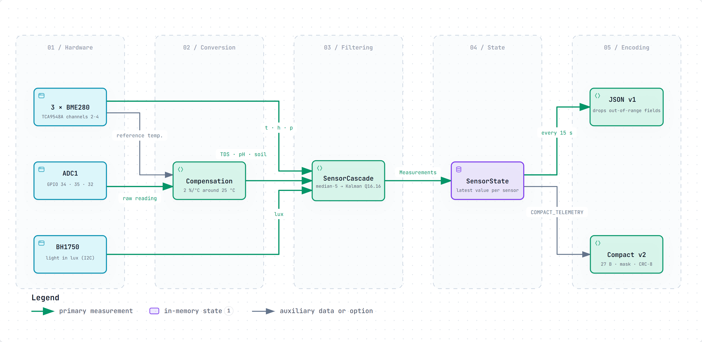
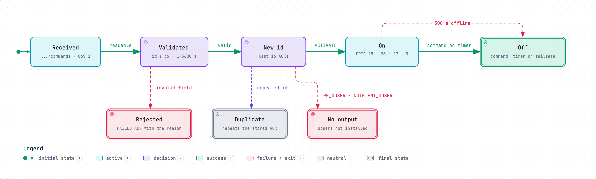
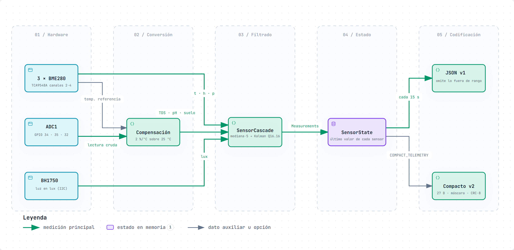
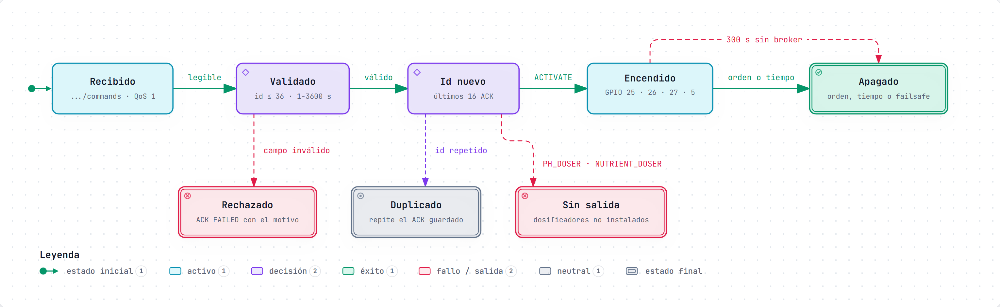

# SmartPot-IoT · Interactive Diagrams

[English](#english) | [Español](#español)

---

## English

Each diagram is a self-contained HTML page that works offline. Download it and open it in a browser to zoom, search
nodes, trace a path and jump to the exact source lines on GitHub. The PNG preview is the light-theme render of the same
diagram.

### 1. From Sensor to Telemetry Packet

How a raw sample becomes a published value. The three BME280 behind the TCA9548A (channels 2 to 4), the BH1750 and the
ADC1 inputs on GPIO 34, 35 and 32 feed one `SensorCascade` per channel: a 5-sample median followed by a Q16.16 Kalman
filter whose 3σ innovation gate drops spikes. TDS and pH are first temperature-compensated with the BME280 reference.
`SensorState` keeps the latest value of each sensor and, every 15 seconds, the MQTT task encodes it as JSON v1 or, when
built with `COMPACT_TELEMETRY`, as the 27-byte compact v2 packet with presence mask and CRC-8.

-
Interactive: [English](SmartPot_IoT_A1_Sensor_Pipeline_Dataflow.en.html) · [Spanish](SmartPot_IoT_A1_Sensor_Pipeline_Dataflow.es.html)
- Sources: `src/tasks/sensors.rs`, `src/filter.rs`, `src/drivers/tds.rs`, `src/protocol/telemetry.rs`,
  `src/tasks/telemetry.rs`, `src/codec.rs`, `src/tasks/mqtt.rs` and `src/config.rs` at commit `4edf73f`.

### 2. Command Lifecycle on the ESP32

What happens to one message on `.../commands`. A payload with a missing or invalid field is answered with a `FAILED` ACK
that carries the reason; an id already in the last 16 acknowledgements only repeats the stored ACK, so a QoS 1
redelivery never toggles the GPIO twice; the dosers, present in the contract but not wired on this board, are rejected.
A valid `ACTIVATE` switches the output on (the pump and the humidifier get a 3600-second cap when no duration is given)
and the actuator turns off by command, by timer or, for critical actuators, after 300 seconds without the broker.

-
Interactive: [English](SmartPot_IoT_A2_Command_Lifecycle.en.html) · [Spanish](SmartPot_IoT_A2_Command_Lifecycle.es.html)
- Sources: `src/tasks/mqtt.rs`, `src/protocol/command.rs`, `src/tasks/command.rs` and `src/safety.rs` at commit
  `4edf73f`.

---

## Español

Cada diagrama es una página HTML autocontenida que funciona sin conexión. Descárgala y ábrela en un navegador para
ampliar, buscar nodos, seguir un recorrido y saltar a las líneas exactas del código en GitHub. La vista previa PNG es el
mismo diagrama en tema claro.

### 1. Del sensor al paquete de telemetría

Cómo una muestra cruda se convierte en un valor publicado. Los tres BME280 detrás del TCA9548A (canales 2 a 4), el
BH1750 y las entradas ADC1 en los GPIO 34, 35 y 32 alimentan una `SensorCascade` por canal: una mediana de 5 muestras
seguida de un filtro de Kalman Q16.16 cuya puerta de innovación de 3σ descarta los picos. TDS y pH se compensan antes
por temperatura con la referencia del BME280. `SensorState` guarda el último valor de cada sensor y, cada 15 segundos,
la tarea MQTT lo codifica como JSON v1 o, si se compila con `COMPACT_TELEMETRY`, como el paquete compacto v2 de 27 bytes
con máscara de presencia y CRC-8.

-
Interactivo: [inglés](SmartPot_IoT_A1_Sensor_Pipeline_Dataflow.en.html) · [español](SmartPot_IoT_A1_Sensor_Pipeline_Dataflow.es.html)
- Fuentes: `src/tasks/sensors.rs`, `src/filter.rs`, `src/drivers/tds.rs`, `src/protocol/telemetry.rs`,
  `src/tasks/telemetry.rs`, `src/codec.rs`, `src/tasks/mqtt.rs` y `src/config.rs` en el commit `4edf73f`.

### 2. Ciclo de vida de un comando en el ESP32

Qué le pasa a un mensaje en `.../commands`. Una carga con un campo ausente o inválido recibe un ACK `FAILED` con el
motivo; un id que ya está entre los últimos 16 ACK solo repite la confirmación guardada, así que una reentrega QoS 1
nunca acciona el GPIO dos veces; los dosificadores, presentes en el contrato pero sin salida en esta placa, se rechazan.
Un `ACTIVATE` válido enciende la salida (la bomba y el humidificador reciben un tope de 3600 segundos si no llega
duración) y el actuador se apaga por orden, por tiempo o, si es crítico, tras 300 segundos sin broker.

-
Interactivo: [inglés](SmartPot_IoT_A2_Command_Lifecycle.en.html) · [español](SmartPot_IoT_A2_Command_Lifecycle.es.html)
- Fuentes: `src/tasks/mqtt.rs`, `src/protocol/command.rs`, `src/tasks/command.rs` y `src/safety.rs` en el commit
  `4edf73f`.

